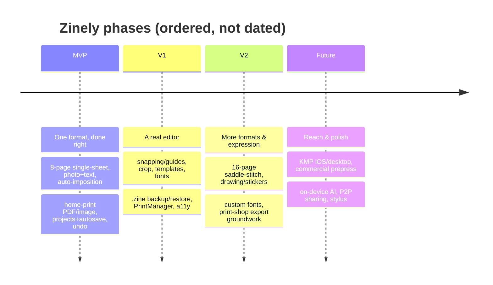
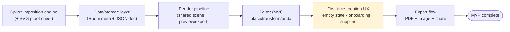
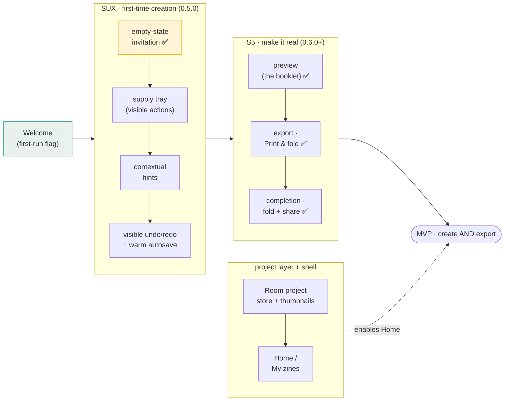

# Zinely — Roadmap

> **The single source of truth for phasing.** *Every roadmap change is reflected here.* Scope detail per phase lives in [PRD.md](PRD.md); the "how" in [ARCHITECTURE.md](ARCHITECTURE.md); rationale in [DECISIONS.md](DECISIONS.md). No dates are committed yet — phases are ordered, not scheduled.

- **Current priorities reviewed:** 2026-10-18 (order of work from [ADR-136](DECISIONS.md#adr-136)). Earlier phase plans below are historical context, not a list of
  promised or still-missing features. Use this current section for next-work decisions.

## Current priorities

**In development** means started (being designed, built or tested) and not in the public download; each entry says which stage it is at ([ADR-118](DECISIONS.md#adr-118), amended 2026-10-06). **Planned** means an accepted
intention to deliver. **Exploring** means a proposal or investigation, not a commitment. **Completed** work belongs in [CHANGELOG.md](../CHANGELOG.md), with public APK changes kept separate
from repository-only changes and website updates. Work listed as In development is in no published APK; an entry at the
design stage has no code on `main`.
The public website projects this list with four labels (Available, In development, Planned, Exploring) grouped by
horizon ([ADR-118](DECISIONS.md#adr-118)).

Reframe loading and the deterministic accessibility regression were completed through
[PR #64](https://github.com/aritr-codes/zinely-android/pull/64). The repository change does not alter the public
beta.4-r3 APK; measurements and evidence remain in the
[release-gap review](reviews/2026-08-27-release-gap-roadmap.md#2026-09-10-reframe-loading-follow-up).

**Released 2026-10-11:** beta.7, folders and a second font, is the public download
([0.9.0-beta.7](../CHANGELOG.md#090-beta7--2026-10-11--folders-and-a-second-font), tag `v0.9.0-beta.7`,
GitHub pre-release, APK only; [tester package](releases/0.9.0-beta.7.md)). It follows beta.6 (2026-10-06). Both
features shipped **not accepted**. No next tester build is scheduled by date yet.

**In preparation, 2026-10-29:** beta.8 (`versionCode 13`) is being prepared on the owner's go-ahead ("Let's wait
for the PR and then go with beta.8"), not yet built, tagged or published; beta.7 stays the public download
until it is. It will carry everything merged to `main` since beta.7, listed in
[the changelog](../CHANGELOG.md#090-beta8--2026-10-29--choose-several-zines-mix-your-own-ink-124-art-pieces-and-work-that-stays-safe)
and the [tester package](releases/0.9.0-beta.8.md): W1 never-lose-work, the 124 Art pieces and two frames, Ink's
mixer and palettes, the Arrange tray, the restored-details note, and choosing several zines on My Shelf. All of it
ships **built and merged, not accepted**; the TalkBack listens are deferred by the owner and are Known
Limitations. Below, "in no download" for an item in that list means: not in the public download today, and in the
beta.8 package once it is published.

**Owner rulings, 2026-09-26** ([1.x decision gate](planning/ZINELY-1X-DECISION-GATE.md)): the next tester build
is planned as a *wave-1* release on the current document format, before any schema change, carrying the 1.x
plan's backup-honesty, accessibility and tap-through steps ([plan §5](planning/ZINELY-1X-IMPLEMENTATION-PLAN.md#5-sequencing)).
Those steps shipped in beta.6 on 2026-10-06.

### Order of work, from 2026-10-18

Decided in [ADR-136](DECISIONS.md#adr-136) under the owner's delegation, after the owner's rulings of
2026-10-15. The items in each wave, their sizes and the cut list are in the ADR; this is the order only. Each
wave still needs its own HTML amendment or ADR where the rules ask for one, and none has a date.

1. **W1 — Never lose work, never get stuck.** Fixes, each with a failing test first. **Built 2026-10-23, in no download** (integrated on `feat/w1-never-lose-work`; Bench A41/A42, Proof A43/A44, Backup A45 and Library A46 frozen under delegation; [ADR-140](DECISIONS.md#adr-140) Proposed, refs #146). **Device checks:** phone Pass 1 done on Samsung SM-A176B, Android 16 (build `09ae4668`); emulator Pass 1 on API 36 and a temporary API 24 AVD (`fda3f095`), with the Proof done-row fix looked at on the emulator at `909c71b9` (2x and a 384dp phone after the fix owed); Pass 2 done 2026-10-24. Owed before it ships: the TalkBack listens, a real out-of-space failure, a real Android 7-9 phone, a device look at the D-146 title, the Bench-open-then-return repair path, the owner's reading, and the CI golden re-record, listed in [OWNER-CHECKLIST §2.5](OWNER-CHECKLIST.md#25-w1-never-lose-work--built-unreleased-device-pass-1-and-a-pass-2-done-talkback-listen-owed). **Partial or untraced against ADR-136's W1 list:** the reduced-motion Proof scroll is not built (the page strip's is); of "stale copy (Replace, share wording)", Replace is done and the only share wording traced is [D-146](design/V2-SPEC-DEFECTS.md#d-146)'s ruling that a failed Share rightly keeps "Couldn't make the PDF"; no other share-wording change was made. The ADR-054 decision 8 "Don't ask again" limitation is closed in code, passed on the API 24 emulator, pending a real phone. *2026-10-29: the owner gave the word; it is in the beta.8 package (in preparation).*
2. **W2a — Small things, no design change; W2b — small things that need an HTML amendment first.** **W2a built 2026-10-29, in no download** (merged in PR #171 → `0d03d1c3`; items 1 to 6 and 8 of [ADR-136](DECISIONS.md#adr-136), as built in its [W2a note](DECISIONS.md#adr-136-w2a); the CI golden check and device checks are owed, listed in [OWNER-CHECKLIST §2.8](OWNER-CHECKLIST.md#28-w2a-small-things--built-unreleased-device-checks-owed)). **Moved to W2b** because each contradicts frozen text: consecutive nudges as one undo step (A33, A22, A26) and the hint's two-finger turn (A33 *THE HINT*). Not started. *2026-10-29: W2b lane A, turning by hand, designed only (Bench A48, [ADR-143](DECISIONS.md#adr-143) Proposed): a turn knob, quarter-turn snapping on the knob, Straighten, and one undo step per run of taps, which settles both moved items.*
3. **W3 — Art: better before more.** The A34 polish as A39, then the Compose redraw ([ADR-132](DECISIONS.md#adr-132)). **Built 2026-10-24, in no download** (on `feat/art-picks`: the 124 A39 pieces in the app, 17 shipped ids redrawn inside their old ink box, 56 names shortened to fit the tile ([D-132](design/V2-SPEC-DEFECTS.md#d-132)); [ADR-139](DECISIONS.md#adr-139) Proposed; the CI golden re-record, a printed page and both device passes are owed)
4. **W4 — Photo descriptions**, saved format v4, alone.
5. **W5 — Print guidance:** designed now, shipped after the print study.
6. **W6 — Paper sizes** (US Legal, A5), saved format v5, and **paper colour shown on screen**, never printed.
   The fields for W8 are designed here, before v5 freezes.
7. **W7 — More Art inside the four families**, from any source that passes the house gates, with variants of
   one subject ([ADR-137](DECISIONS.md#adr-137), Proposed). *2026-10-24: the A39 picks add 90 new pieces, built with
   W3 under [ADR-139](DECISIONS.md#adr-139); in no download.*
8. **W8 — Your own artwork.**
9. **W9 — A third voice, Hand** (Shantell Sans).
10. **Later:** Recently deleted first; then a hidden signature in the PDF's metadata, the pen tool, shaped photo
    cutouts, a 16-page booklet, device-to-device transfer, tablets and keyboard shortcuts, an RTL check and
    back-page credits.

### Where the list stands, 2026-10-12 (updated 2026-10-18)

**Not everything on the last list is finished.** Four built items are not accepted, and six items are not
built. "Built" below means merged to `main`; "accepted" means the ADR says Accepted.

| Item from the last list | Built | In the download | Accepted | What is still owed |
|---|---|---|---|---|
| Backup honesty, reading order, named undo | yes | beta.6 | yes ([ADR-119](DECISIONS.md#adr-119), [120](DECISIONS.md#adr-120), [122](DECISIONS.md#adr-122), [123](DECISIONS.md#adr-123); ADR-123 with its remaining device passes waived and recorded) | Nothing for acceptance. A restore onto a second phone is still untried (plan D1 part 2). |
| Tap-through ([ADR-124](DECISIONS.md#adr-124)) | yes | beta.6 | **no** | Owner's TalkBack listen; freeze of bench A27. |
| Shelf folders ([ADR-125](DECISIONS.md#adr-125)) | yes | beta.7 | **no** (design accepted) | TalkBack listen; six small owner rulings. |
| Document voices, Book and Plain ([ADR-126](DECISIONS.md#adr-126)) | yes | beta.7 | **no** | A printed Book page at 12 pt; TalkBack listen; owner's own try and rulings. |
| Two frames (plan step 9) | yes | **no** (beta.8, in preparation) | **no** | Owner's first-time pass with a finger; TalkBack listen; one printed page. |
| Print guidance (plan step 5) | no | no | no | Blocked on the print study, which has not been run. |
| Photo descriptions (plan steps 6 and 7) | no | no | no | What Read says aloud is designed (`v21-proof.html` A38, frozen; [ADR-135](DECISIONS.md#adr-135) Proposed; PR #141). Owed: the v4 format step, the build, both device passes and the owner's TalkBack listen. |
| Page backgrounds | no | no | no | Answered by paper colour shown on screen and never printed, in W6 ([ADR-136](DECISIONS.md#adr-136) decision 5, which keeps ZINE-DIRECTION's "do not build" line for a printed fill). No design yet. |
| More paper sizes | no | no | no | [ADR-133](DECISIONS.md#adr-133): US Legal and A5 chosen; the engine takes any sheet (merged, PR #129). The A35 picker is designed (`v21-library.html` A35, frozen; PR #142). The sizes wait on their own schema bump after v4. |
| A page that keeps its size, the Arrange tray (added 2026-10-14, from *Exploring*) | yes (PR #133) | **no** (beta.8, in preparation) | yes, under the owner's delegation ([ADR-129](DECISIONS.md#adr-129)); the owner can overrule | TalkBack listen of the tray; a real small phone at large text. The first-run hint no longer clips its words at the largest text, a problem beta.7 also has ([D-119](design/V2-SPEC-DEFECTS.md#d-119), PR #143; checked on an emulator, the real small phone owed). |
| A note when a zine's details go back to their earlier copy (added 2026-10-18, from [#128](https://github.com/aritr-codes/zinely-android/issues/128)) | yes (PR #139) | **no** (beta.8, in preparation) | yes, under the owner's delegation ([ADR-134](DECISIONS.md#adr-134)); the owner can overrule | A TalkBack listen; a real phone at 360dp and font scale 2; the owner's first-time reading of the words. Follow-ups [#145](https://github.com/aritr-codes/zinely-android/issues/145)–[#147](https://github.com/aritr-codes/zinely-android/issues/147). |
| Google Play | no | no | no | Owner's account verification is still blocked. |
| Fold clarity study | no | no | no | Needs first-time makers with paper. Not run. |

Most owner items in the "still owed" column are indexed in [OWNER-CHECKLIST](OWNER-CHECKLIST.md). Not yet indexed
there: the two-phone restore pass and the tester's screenshots.

**Known problems in the current download (beta.7).** The first four are fixed on `main` (the first three
2026-10-14, the fourth 2026-10-18) and are not yet in a download. D-119's tests and passes found two more that
it does not fix, each needing a `v21-bench.html` amendment first: at the largest text on a 360dp screen the
low-storage save-failure notice's two buttons squeeze its words into a column taller than the screen (found by
a test, not seen on a device; [#149](https://github.com/aritr-codes/zinely-android/issues/149)), and the hint covers the piece it asks you to drag ([#148](https://github.com/aritr-codes/zinely-android/issues/148)).

- At the largest text size the Align row crowds and "Right" breaks across lines
  ([#102](https://github.com/aritr-codes/zinely-android/issues/102)). The issue's second half, the unreachable
  Colour row, was measured on beta.6 and is mended in beta.7 by the card scrolling
  ([ADR-126](DECISIONS.md#adr-126), *As built*); the issue text is stale on that point. *Fixed on `main`: a row that does not fit moves its choices under its
  label ([D-115](design/V2-SPEC-DEFECTS.md#d-115)).*
- The notice shown while typing can say a character "can't print yet" when it does print, from another font
  ([#103](https://github.com/aritr-codes/zinely-android/issues/103)). *Fixed on `main`
  ([ADR-130](DECISIONS.md#adr-130)).*
- Seen once, on a debug build with a file damaged by hand: after a repair from the spare copy, a zine's details
  can go back to an older title while the Shelf keeps the newer one. Pages are not affected
  ([#106](https://github.com/aritr-codes/zinely-android/issues/106)). *Fixed on `main`
  ([D-116](design/V2-SPEC-DEFECTS.md#d-116)).*
- At the largest text on a small phone the first-run hint, shown the first time a piece is placed, cuts off
  its first and last words: its round ends grow with its height
  ([#134](https://github.com/aritr-codes/zinely-android/issues/134)). *Fixed on `main`: a tall hint's corners stop growing at 40dp
  ([D-119](design/V2-SPEC-DEFECTS.md#d-119), PR #143); checked on an emulator only.*
- **Tester feedback, 2026-10-12 (owner's report):** the interface breaks in places, and many Art pieces look
  amateurish. The places are **not yet recorded**: no screenshot or screen name has reached the repository, so
  nothing here is triaged or reproduced.

### In development — started (designing, building or testing), not in the public download

- **A note when a zine's details go back to their earlier copy** ([#128](https://github.com/aritr-codes/zinely-android/issues/128)):
  My Shelf names the zine, says what went back, and keeps the note until "Got it". Designed as
  `v21-library.html` A37 and built (PR #139, [ADR-134](DECISIONS.md#adr-134) Accepted under delegation); both
  emulator passes passed on 2026-10-18. In no released APK; a TalkBack listen and a real-phone check are owed.

- **Two hand-cut frames** (plan step 9): Snipped border and Round window, in Cut paper (A32 put them at its end;
  A39, [ADR-139](DECISIONS.md#adr-139), now follows each with its variants and new pieces). Design frozen
  2026-10-12 ([`v21-bench.html` A32](design/mockups/v21-bench.html)); built and merged to `main` on the owner's instruction 2026-10-12 (PR #119, `7f8980a`),
  not accepted and in no released APK. Whether the thin Snipped border can be picked back up over a
  photo is the open question for the owner's first-time pass: its band measured about 10 to 12 dp wide on the
  reference phone, with no forgiveness over a photo ([ADR-124](DECISIONS.md#adr-124), *Review*).

- **Inks you mix yourself:** a colour mixer, My inks and My palettes in the Ink tray. Designed as
  `v21-bench.html` A40 rev. 2 and built 2026-10-26 on `feat/ink-mixer` ([ADR-138](DECISIONS.md#adr-138), Proposed).
  In no published APK; in the beta.8 package (in preparation). Tried on an emulator and a Samsung phone
  (maintainer's record, not in this repository); what is owed is listed in
  [OWNER-CHECKLIST §2.6](OWNER-CHECKLIST.md#26-ink-mixer--built-merged-in-the-beta8-package-listens-and-parity-owed).

- **My Shelf multi-select:** press and hold a zine to choose several, then Move to a folder or Delete them, with one
  Undo for the whole batch. Moved from Planned on 2026-10-26, when the owner asked for it in `0.9.0-beta.8`:
  designed as `v21-library.html` A47 (frozen under delegation) and built and merged for beta.8
  (PR #167, then PR #168 for the review follow-ups of #166; [ADR-142](DECISIONS.md#adr-142), Proposed; it replaces
  [ADR-141](DECISIONS.md#adr-141) decision 3). Beta.8 is in preparation, so it is in no published APK. What is owed
  before it is accepted is in
  [OWNER-CHECKLIST §2.7](OWNER-CHECKLIST.md#27-shelf-multi-select--built-merged-in-the-beta8-package-listen-owed). The Bench stays
  single-select.

Shelf folders and document voices (Book and Plain) shipped in `0.9.0-beta.7` on 2026-10-11
([CHANGELOG.md](../CHANGELOG.md#090-beta7--2026-10-11--folders-and-a-second-font)). Both shipped **not accepted**:

- **Shelf folders:** [ADR-125](DECISIONS.md#adr-125) is Accepted as a design; the implementation still owes a
  TalkBack listen and the owner's rulings listed in [OWNER-CHECKLIST](OWNER-CHECKLIST.md).
- **Document voices:** [ADR-126](DECISIONS.md#adr-126) stays Proposed until the printed page that confirms
  Book's 12 pt minimum, a TalkBack listen and the owner's own try.
- Tap-through, shipped in beta.6, is also still **not accepted**: [ADR-124](DECISIONS.md#adr-124) stays
  Proposed until the owner's TalkBack listen and the A27 freeze.

### Planned

Owner-stated intentions to deliver. None has a date, and "Planned" here does not mean designed: each still needs
its HTML specification frozen and an ADR before any Compose work.

- **Art quality pass** (owner, 2026-10-12, after tester feedback): the Art pieces are to be redrawn to one
  house style so they look made by one hand. Design frozen (`v21-bench.html` A34,
  [ADR-132](DECISIONS.md#adr-132) Proposed); Compose redraw and Art golden re-record not started. *2026-10-18:
  this is W3; A34 is polished as A39 first, and the set's rule now reads "one world"
  ([ADR-137](DECISIONS.md#adr-137), Proposed). The A39 candidate sheet is made and waits for the owner's
  picks; A34 is not wired into the app until then.* *2026-10-22: the owner picked 125 drawings; A39 is frozen
  under [ADR-139](DECISIONS.md#adr-139) (Proposed): 124 outlines, 17 shipped ids redrawn and 90 new ids. Not
  wired yet.* *2026-10-24: wired on `feat/art-picks` (all 124, names shortened to fit the tile,
  [D-132](design/V2-SPEC-DEFECTS.md#d-132)); in no download. The CI golden re-record, a printed and photocopied
  page and both device passes are owed.*
- **Print guidance:** help at the print step so a sheet comes out at the right size (plan step 5). Still gated
  on the print study; one successful print by a user, reported by the owner, is recorded in the plan as
  evidence, not as the study. *W5: design now.*
- **Photo descriptions (alt text):** plan step 7; needs the v4 format step. What Read says aloud is designed
  (`v21-proof.html` A38, [ADR-135](DECISIONS.md#adr-135) Proposed); nothing is built. *W4, before any v5 work.*
- **Page backgrounds:** a background for a page, behind its photos and words (owner request 2026-10-06). The
  document and the renderer already carry a per-page `background` (none, or a solid colour); nothing in the
  editor sets it, so it is `none` in every zine made today. No picker or design exists yet. *2026-10-18
  ([ADR-136](DECISIONS.md#adr-136) decision 5): answered by paper colour in W6, the paper the maker loads,
  shown on screen. A printed fill stays out, because a home printer prints it as a panel inside a white margin.*
- **More paper sizes:** today a zine prints on A4 or US Letter only (owner request 2026-10-06).
  [ADR-133](DECISIONS.md#adr-133) chose US Legal and A5 and made the imposition engine take any sheet; the
  sizes need their own schema bump after v4 before anyone can choose them; the picker is designed
  (`v21-library.html` A35, frozen 2026-10-15) and not built. *W6.*
- **Google Play publication**, after owner account verification, mandatory testing and store review. Account
  verification remains blocked; the signed GitHub beta and public policy already exist. This is a distribution
  task, not a reason to rebuild or overwrite the current beta. [Release authority](RELEASING.md#3-beta-distribution-side-load).

### Exploring — recommended next decisions, in order

1. **Fold clarity:** observe first-time makers using the existing app guide and the ten-step website guide with
   paper. Record cut mistakes, hesitation and completion without coaching. Change diagrams or add motion only
   if evidence identifies an improvement. The website guide is shipped; native replay is not.
2. **Creative tools:** more Art, photo transparency, shaped cutouts and crop improvements stay under
   evaluation (reopened 2026-09-12; see the assessment below). Fonts and frames left this list for *Planned*
   on 2026-10-06, following the owner's 2026-09-26 rulings. No delivery date is committed. *2026-10-18: more
   Art is W7 and shaped cutouts are Later ([order of work](#order-of-work)); photo transparency rides W8.*
3. **Wider customisation** (owner's ideas, 2026-10-12; evaluated the same day, nothing decided). Each is listed
   with what stands in its way, because several reverse rulings already on record:
   - *Colours of your own* (a hex picker): [ZINE-DIRECTION](design/ZINE-DIRECTION.md) §8 says "Free colour
     picker / font picker: DO NOT BUILD". The evaluated middle path is inks a maker mixes and saves, not a free
     picker on every tap. Needs the owner to amend that line, then a design and an ADR.
     *2026-10-26: decided by [ADR-138](DECISIONS.md#adr-138) (Proposed; it amends that line) and now under
     [In development](#in-development--started-designing-building-or-testing-not-in-the-public-download).*
   - *Saved colours, font pairs and favourite pieces:* Art favourites and recents exist but are held in memory
     only; nothing saves colours or styles. No design.
   - *Your own artwork:* every stored image is a JPEG, so transparency is lost and a cut-out shows a white box
     ([ADR-023](DECISIONS.md#adr-023)). Needs an alpha-preserving image format, a backup-format change and its
     own ADR first. *2026-10-18: W8, trying a cheaper path first ([ADR-136](DECISIONS.md#adr-136)).*
   - *Photo fixes* (black and white, levels, background removal): [PRD §7.2](PRD.md) puts adjustments beyond crop
     out of MVP scope; Copier already gives a 1-bit look. Background removal is rated large in the assessment
     below and no on-device model has been tried. *2026-10-18: background removal is cut (it needs a model
     download and is an AI feature; [ADR-136](DECISIONS.md#adr-136)).*
   - *More fonts, and generated variations:* a third voice is blocked on glyph coverage and an owner ruling.
     *2026-10-18: the owner's ruling is given; Hand (Shantell Sans) is W9, after its own coverage check
     ([ADR-136](DECISIONS.md#adr-136)).*
     Randomised variation was refused in [ADR-107](DECISIONS.md#adr-107) and stays refused unless the owner
     reopens it.
   - *HTML, CSS and JavaScript for drawing Art:* already how pieces are specified (the bench file, checked
     against Kotlin by a parity test). Not a candidate for drawing inside the app, where one renderer keeps
     screen, Read and PDF identical.
4. **A page that keeps its size when something is selected.** *Decided and built 2026-10-14:* the move,
   size, turn and layer buttons moved into a tray opened from the verb bar's Arrange
   ([ADR-129](DECISIONS.md#adr-129), Accepted under the owner's delegation; `v21-bench.html` A33; PR #133). It
   reverses the owner's OD-11 ruling, which the owner can overrule. Not in a download.

### Engineering follow-ups — not extra public feature promises

- Add a blocked-loader regression proving a cancelled or superseded Reframe load cannot publish stale state,
  if this boundary changes again. Preserve the raw measurement and trace-hash record in the release-gap review.
- About maker's note: HTML/Compose pixel parity for About and its pages is recorded as **not verified** in the
  [beta.5 release notes](releases/0.9.0-beta.5.md#not-verified), and [ADR-116](DECISIONS.md#adr-116) still reads
  "native verification pending". Run the parity check and update ADR-116's status; the focus-return gate became a
  Known Limitation by owner ruling.
- Save PDF on a real Android 7–9 phone: beta.5's storage-permission path was verified on an Android 9 emulator only.
- Verify backup/restore on a second Android/API environment and realistic interrupted/low-storage providers.
  Treat this as coverage expansion, not a claim that the accepted Samsung recovery path is broken. Do not fill,
  wipe or uninstall the owner's device to manufacture a test condition.
- Reconcile issue/PR and owner-checklist drift using the
  [current evidence review](reviews/2026-08-27-release-gap-roadmap.md#2026-09-09-current-state-review).
  Issues #53 and #55 were closed with implementation evidence. Issue #54 was evaluated and closed without an
  element-menu implementation: the visible toolbar and accessibility actions already expose the operations, while
  no post-fix first-time round has demonstrated a discovery failure that justifies a duplicate hidden menu.
- PR #63 merged to `main` at `7d0960b`; its Android/core CI passed and the main-only Pages deployment is live.
  Preserve old branches/worktrees and frozen release artifacts.

The owner-published Google feedback form is linked from the website; the 90-day policy and email fallback
are in [PRIVACY-POLICY.md](PRIVACY-POLICY.md#feedback-and-email). Completed website work belongs in the
changelog, not in the feature backlog. No app feedback screen or SDK is planned.

**Parked, not next:** Art cold-entry precomposition (latest trace did not justify a safe local change), image
garbage collection (import/undo/recovery safety prerequisites), shelf search/sort (owner previously removed them;
needs real-library evidence), extra formats and new menus. Catalogue expansion stays under evaluation
above; document voices shipped in beta.7 and two frames are *In development* (merged, not accepted, in no released APK), with no date. Other parked work can be reconsidered
when a concrete user problem warrants it; the app is not declared final.

### Creative tools assessment (2026-09-12)

**Recommendation, not an estimate or release promise.** Relative effort includes design, implementation, saved-file
compatibility, undo, accessibility and matching print output. No calendar estimate until a specific tool is frozen.

| Capability | Existing foundation and missing work | Relative effort |
|---|---|---|
| Curated document fonts | `TextStyle.fontFamily`, `DocumentFontRegistry` and `BundledFontResolver` already exist. Only Inter is registered for zine content; app-interface fonts are a different set. Add curated font assets/styles, a picker, reducer patch/undo, glyph/fallback checks, and identical editing/preview/PDF layout. | Medium |
| More authored graphics and stickers | `DecorElement`, `SupplyCatalog`, Add Art, ink and transforms exist. A small pack of single-colour authored marks can reuse them. Imported or multicolour stickers need separate import/tint/alpha and ownership decisions. | Small to medium for a curated pack; higher for a general sticker system |
| Frames | An independent decorative frame can reuse an Art outline. A frame attached to a photo must resize/crop/duplicate/undo as one unit and survive save/export. Those are different features. | Small to medium for decorative overlays; medium to large for attached frames |
| Photo transparency | No per-image opacity field exists in `ImageElement` or `DrawImage`. Add a validated saved value, slider/undo semantics and consistent image paint in preview and PDF, including interaction with Copier. Existing source-image alpha is not a user opacity control. | Medium |
| Circle, oval or rounded photo cutouts | `Crop` and command clips are rectangular. Add non-destructive mask metadata, selection/hit-test behavior, shape-aware rendering and preserved original photo bytes. Platform path clipping exists, but the app document/render contract must carry it. | Medium to large |
| Freehand snipping or automatic background removal | Freehand needs a path editor, simplification, accessible alternatives, mask storage and edge-quality tests. Automatic removal is a separate on-device inference, model-size and quality investigation, not an extension of the crop slider. | Large; investigate separately |
| Better cropping | Reframe already supports rectangular framing. First identify the missing task: aspect presets/reset/straightening/handles have different costs. Preserve photo transforms and undo rather than replacing the whole editor. | Small to medium for focused improvements; large for a new crop model |

**Recommended first creative slice:** a small, visibly distinct set of bundled fonts with a real picker, followed by
a curated Art pack and decorative frames. Evaluate transparency next, preset shape cutouts after that, and leave
freehand/automatic cutting for a separate design effort. This recommendation does not reorder the retained release,
fold-study or acceptance gates without owner approval.

> **Owner rulings, 2026-09-26** ([decision gate](planning/ZINELY-1X-DECISION-GATE.md)): the fold-clarity study
> runs now but **no longer gates** fonts or frames (Q5); fonts start as **two named voices** — Book (Fraunces)
> and Plain (Inter), with Hand (Averia) deferred (Q2); frames start as **two** hand-cut pieces
> whose names and look await the owner's visual approval (Q6).

All new features must preserve old zines and the rule that the preview matches what prints. Unknown-font fallback
must not silently become layout loss. *(For document voices, qualified by the owner on 2026-09-26, [gate Q2](planning/ZINELY-1X-DECISION-GATE.md#q2-typefaces-o12--o8): no schema bump; an older build keeps and restores the content and may draw an unknown voice as Inter, which is documented and tested as a layout change, not data loss.)* Photo-opacity exploration does not overturn the deliberate no-opacity rule
for authored Art in `SUPPLIES-SPEC`. Sources and API boundary notes: [RESEARCH R20](RESEARCH.md#r20-creative-tools-feasibility-12-september-2026).

## Historical phase context

The older sequencing, dated launch runway and conformance statuses below are preserved for provenance. They do
not override the current priorities or establish release readiness. Many capabilities in them have since shipped.

## Phase overview

## Guiding sequence

The build order inside every phase follows risk: **prove the riskiest, most isolatable thing first.** That is why the **imposition engine** (pure Kotlin, fully testable) is the first vertical spike — see [spikes/imposition-engine.md](spikes/imposition-engine.md) and [ADR-007](DECISIONS.md#adr-007).

### Public launch runway — 2026-09-11

The owner set **11 September 2026** as the public-launch date on 2026-08-26. The remaining runway is a
stabilisation programme, not permission to widen scope. Repository evidence, release-candidate device behavior
and print output outrank feature count.

| Window | Gate | Required outcome |
|---|---|---|
| **26–29 Aug** | Scope and defect closure | Freeze the accepted Art + Ink surface; classify the stakeholder pass; reproduce current-release gaps; keep persistence, export, backup/restore and print parity green |
| **30 Aug–3 Sep** | Focused implementation | Implement A16 through existing supply/render seams; resolve the inert typing-row ruling; add only contextual discoverability improvements proven by feedback; no new architecture |
| **4 Sep** | **Feature freeze** | No new capability enters after this date without a P0 launch-blocker finding |
| **5–7 Sep** | Release-candidate verification | Full JVM/Android/lint/debug/release gates; explicit golden reruns; two physical-device passes; backup/restore, edit/autosave, Proof, PDF and physical fold smoke |
| **8 Sep** | RC handoff | Signed candidate, release notes, privacy/known-limitations text and stakeholder smoke package |
| **9 Sep** | Stakeholder acceptance | Only evidenced P0/P1 corrections; no visual or feature expansion |
| **10 Sep** | Release lock | Version/signing/install/upgrade checks; final diff and clean-tree audit |
| **11 Sep** | Public launch | Publish the accepted signed artifact and support/reporting instructions |

**Launch Musts:** crash/data-loss safety; additive `.zine` backup/restore; autosave/session ownership; editor
create/edit/undo/redo; accurate shared preview/PDF rendering; correct imposition and fold guidance; usable
first-run/shelf navigation; accessible primary flows; **deterministic offline emoji printing**; and the accepted
**one-photo-across-the-fold** action. Both are implemented: emoji passed [ADR-112](DECISIONS.md#adr-112)'s
real-device raster/PDF gate, and spreads passed [ADR-109](DECISIONS.md#adr-109)'s reducer, export-seam and first
physical-device interaction checks. The release-candidate physical print/fold smoke remains part of the 5–7 Sep
gate rather than being waived by implementation evidence.

**Launch candidates, only while the Musts stay green:** the already-approved A16 Art + Ink implementation;
small contextual guidance for alignment/resize/rotate/Reframe; a user-controlled post-save PDF-open affordance.

**Deferred beyond launch:** broad onboarding/tutorial systems, cloud/accounts/social features, new formats,
and direct printing without fixed-scale proof. The
[stakeholder feedback review](reviews/2026-08-26-stakeholder-feedback.md) records why these are not all the same
kind of gap.

> **Sequencing change (2026-06-28).** A repository UX audit confirmed the editor is
> *functionally* strong but *emotionally* intimidating for the beginner-first audience
> ([ADR-008](DECISIONS.md#adr-008)): it opens to a near-blank sheet, core actions hide behind
> gestures, and the chrome reads like generic productivity software. So a **first-time creation
> experience** milestone (`SUX`) is inserted **before** the export flow (S5): cozy empty state,
> contextual onboarding, a visible scrapbook supply tray, discoverable add-text/undo-redo, and
> "all 8 pages together." Rationale: export has no value if a first-time user never makes a page
> they want to print — *reduce intimidation before adding power*. The design references are anchored
> by [docs/design/DESIGN-LANGUAGE.md](design/DESIGN-LANGUAGE.md) (companion references under the
> canonical doc system in [CLAUDE.md](../CLAUDE.md)). S5 and the Room-backed project
> layer are unchanged in content, only resequenced after `SUX`.

### Journey-ordered build sequence (product design sprint, 2026-06-28)

A product design sprint produced the canonical blueprint — [DESIGN-LANGUAGE.md](design/DESIGN-LANGUAGE.md)
(hub), [VOICE.md](design/VOICE.md), [EXPERIENCE-MAP.md](design/EXPERIENCE-MAP.md),
[SCREEN-INVENTORY.md](design/SCREEN-INVENTORY.md), [DESIGN-RULES.md](design/DESIGN-RULES.md), and the
[HTML prototypes](design/mockups/index.html). Its core sequencing principle: **build the product in
the order a first-timer lives it** (the [emotional arc](design/EXPERIENCE-MAP.md#1-the-emotional-arc-target)),
not feature-by-feature, so each slice delivers a felt win that funds the next.

> **Why this order.** The two journey **peaks** are *first photo placed* (already unlocked) and
> *print & fold* (S5) — so `SUX` finishes making the *creation* moment delightful, then S5 delivers
> the *payoff*. **Welcome is decoupled** (Codex review): it is *not* Room-gated — it routes straight
> to the editor on the `"default"` project behind a local first-run flag, so it can ship early as
> part of the first-run experience. Only **Home/My-zines** is sequenced **with the Room project
> layer** (plus shelf thumbnails) — it has no value until there is more than one project to shelve,
> and it is off the critical path to the MVP "create **and** export one zine" exit.
> Stickers/templates remain V1 expression. Each screen's build readiness is tracked in
> [SCREEN-INVENTORY.md](design/SCREEN-INVENTORY.md#coverage-check-screen--milestone).
>
> ⚠️ **This is build *sequencing*; the Welcome-first first-run flow itself is a PRD-owned change
> that is *proposed, pending ratification* in [PRD §9](PRD.md#9-navigation-map-mvp)** (plus a
> navigation ADR amending [ADR-030](DECISIONS.md#adr-030)). The order here is what we build *if/when*
> that flow is approved; until then the [PRD navigation map](PRD.md#9-navigation-map-mvp) stays
> authoritative for the flow.

> **Status:** **S1–S4 are implemented and on `main`.** S1 imposition engine (pure-Kotlin `:core:model` + `:core:imposition`, 95 tests, milestone `v0.1.0-imposition-engine`); S2 persistence (`:core:data` contracts + pure-JVM `:core:data-storage` durability core/asset store + Android `:data-android` adapters); S3 render (`:core:render` pure tier + `:render-android` PDF/raster backends); S4 editor (`:core:editor` MVI core + `:feature:editor` interaction surface, now **mounted in `:app`** with interactive image import and autosave). Each was TDD'd and Codex-reviewed per increment.
>
> **Post-S4 tracks:** the S5 export/share flow is complete, and **S6.1 landed the Room-backed `ProjectRepository`** ([ADR-042](DECISIONS.md#adr-042)) — a real, observable multi-project metadata store in `:data-android` (files remain the source of truth; the S4 `"default"` seed is adopted as an ordinary row) — and **S6.2 built the read-only Home/My-zines shelf** ([ADR-043](DECISIONS.md#adr-043)) — `HomeScreen` + `HomeViewModel` over `observeProjects()`, fully tested — and **S6.3 added the shelf actions** ([ADR-044](DECISIONS.md#adr-044)): create/rename/duplicate/undoable-delete behind the ADR-042 open-editor exclusion, now enforced **inside the repository** (`ProjectSessionGate` → `DataError.Busy`). **S6.4 added page-1 card thumbnails** ([ADR-045](DECISIONS.md#adr-045)) through the shared render parity path, and **S6.5 wired Home in and re-rooted navigation** ([ADR-046](DECISIONS.md#adr-046)): `HomeRoute` is the start destination and single back-stack root, the `"default"` seed-on-miss is retired (first run lands on the Empty-shelf CTA; a missing project is an honest boot error), and a fast reopen awaits the single-writer release through the shared session-gate policy. **The S6 multi-project & Home track is complete.** The **asset GC/sweeper remains deferred** ([ADR-031](DECISIONS.md#adr-031) §2 — blocked until imports pin).
>
> **Compose V1 parity re-skin track (2026-07-08 →, branch `feat/m0-design-system`, merged to `main`).** The three V1 surfaces are DESIGN-FROZEN as an HTML trilogy (Shelf/Bench/Proof) and are being re-skinned onto the shipped `v0.6.0-alpha.1` app — a **re-skin, not a rebuild**; behaviour (nav / MVI / ViewModels / Hilt / a11y mirror / render parity) is invariant. Execution order and shape live in [COMPOSE-V1-PARITY-PLAN.md](COMPOSE-V1-PARITY-PLAN.md) (a planning artifact, not scope authority). Milestones: **M0 design-system ✅** ([ADR-048](DECISIONS.md#adr-048)), **M1 shared components ✅** ([ADR-049](DECISIONS.md#adr-049)), **M2 Shelf ✅**, **M3 Bench ✅** (M2/M3 are pure reskins — no ADR); **M4 imposition-truth checkpoint** — reshaped by the [2026-07-11 reconciliation](reviews/2026-07-11-m0-m3-reconciliation.md) to **fold into M5** (its derive-and-guard core already shipped pre-plan in S7.2); **M5 Proof (the Fold) ✅ complete** — batched in [m5-proof-batching.md](spikes/m5-proof-batching.md) (B1→B5), all landed ([ADR-051](DECISIONS.md#adr-051)): the former Preview/Export/Completion triad collapses into one 3-act `ProofRoute`/`ProofScreen`, the reading-order reader-booklet is retired as superseded by the imposed-sheet-first Proof, Act 1 renders the engine-ordered imposed sheet (`decorativeImpositionRows` relocated into the Proof, drift guard extended — no raw imposition array in Compose), Act 2 is the honest print recipe with a two-action export row (the in-app Print action dropped, [ADR-052](DECISIONS.md#adr-052)), and Act 3 is the five-step fold guide + the staged finished-book climax (cover-close → settle → shelf-line → words → exits in timed beats, the `success` haptic, a reduced-motion path that jumps straight to the finished state). **B5 retired the three legacy screens/routes/tests** (only code proven unreachable) and sealed the surface with the recoverable export-error overlay + the ADR-041 "Fold now" post-export hand-off (loading-sweep/empty/toast overlays are documented deferrals — prototype-simulated states with no wired data signal). **M6 full-app sign-off is complete** (CI-recorded goldens `d8c9635`, F3 TalkBack a11y fix `5b3003d`). The frozen Proof imposed-sheet illustration was corrected to the engine as a recorded freeze amendment ([ADR-050](DECISIONS.md#adr-050)). All of M0–M6 is now **merged to `main`**.

---

## MVP — "one great format, done right"
**Goal:** a beginner prints a correct 8-page zine in under 10 minutes, fully offline.

- 8-page single-sheet zine; Letter + A4.
- Photo placement (move/resize/rotate, fit/fill); text placement (size/color/align/bold/italic — [ADR-055](DECISIONS.md#adr-055); one bundled family, font *choice* is V1).
- Single/double/full per-page layouts.
- Automatic imposition ([ADR-007](DECISIONS.md#adr-007)).
- Home-print-ready PDF (vector text) + 300 DPI image export ([ADR-001](DECISIONS.md#adr-001), [ADR-011](DECISIONS.md#adr-011)).
- Print correctness: safe area, fold/cut guides, calibration ruler, "Actual size" guidance ([ADR-012](DECISIONS.md#adr-012)).
- Projects: create/open/duplicate/delete, thumbnails.
- Autosave + crash recovery ([ADR-009](DECISIONS.md#adr-009)).
- Command-based undo/redo ([ADR-005](DECISIONS.md#adr-005)).
- Share via FileProvider; in-app fold instructions.

**Exit criteria:** all MVP functional requirements in [PRD §10](PRD.md#10-functional-requirements-mvp) pass; printed test zines fold to 1→8 reliably; no network calls; no crash data loss in dogfooding.

## V1 — "a real editor"
- Snapping / alignment guides ([R5.4](RESEARCH.md#r54-scene-model-hit-testing-snapping--verified--assumption)).
- On-device crop / rotate / basic adjustments (no remote processing).
- Templates & themes; richer typography; **font choice** + bundled font expansion (reclassified out of the FR-3 MVP Must, [ADR-055 §1](DECISIONS.md#adr-055)).
- Page reorder / duplicate.
- **`.zine` backup & restore** via SAF ([ADR-009](DECISIONS.md#adr-009)).
- Android **PrintManager** in-app print path ([R2.3](RESEARCH.md#r23-system-print-framework--recommendation)).
- Calibration test sheet; thumbnails everywhere.
- Full accessibility pass; dark theme; Baseline Profile.
- **Supplies — the decorative third primitive** (`DecorElement`; [ADR-105](DECISIONS.md#adr-105),
  [ADR-104](DECISIONS.md#adr-104), [SUPPLIES-SPEC](design/SUPPLIES-SPEC.md)). Phased **P1 ink reaches
  paper · P2 the drawer · P3 the Art sheet**; §10.1 of the spec owns the per-phase detail, this row owns
  the phasing's place in the plan. **[ADR-107](DECISIONS.md#adr-107) now accepts a staged 16→32 first
  expansion; [D-080](design/V2-SPEC-DEFECTS.md#d-080) and [D-107](design/V2-SPEC-DEFECTS.md#d-107) closed
  when the owner accepted A16's combined Art + Ink DESIGN FREEZE on 2026-08-26.**
- **The V2.1 re-skin** — Library, Bench and Proof re-drawn against `V21-SPEC.md`
  ([ADR-100](DECISIONS.md#adr-100) · [ADR-101](DECISIONS.md#adr-101) · [ADR-102](DECISIONS.md#adr-102), all
  Accepted). ⚠ **Partly landed.** The eight Library composables are on `main`; `ZineV21Cover` and
  `ZineV21CoverMarks` are not, and `feat/supplies-p3-art-sheet` carries a **divergent** version of all
  eight — see [D-102](design/V2-SPEC-DEFECTS.md#d-102).
  ⚠ **Corrected 2026-08-19:** this row said *"Landed as one squash, PR #58."* **PR #58 is the supplies
  PR** — *"feat(supplies): share-in, the photocopier, and the tape for sixteen supplies"*, merged
  2026-08-17 (`gh pr view 58`). The Library work reached `main` through the Phase B commits
  (`4231175`, `1e097ab`, `946d6a9`, `97744e6`, `03223da`), not through #58.

## V2 — "more formats & expression"
- Additional impositions: 4-page, **16-page saddle-stitch** (double-sided + binding guidance) — a distinct imposition family ([R1.7](RESEARCH.md#r17-variants--pitfalls--disputed--assumption)).
- Drawing / stickers / freehand layer.
- **Custom font import** (`.ttf`).
- **Print-shop export groundwork**: bleed, trim/crop marks, margins — still RGB ([ADR-002](DECISIONS.md#adr-002)).
- ~~**`X9` — multi-page spreads**~~ moved into the 2026-09-11 Launch Musts by the owner's 2026-08-26 scope
  ruling and accepted [ADR-109](DECISIONS.md#adr-109). It remains two ordinary images with no schema or
  imposition change; V2 does not carry a second implementation of it.
- Batch export; grid/layers panel.
- Optional, explicit, user-initiated community sharing (network strictly opt-in).

## Future vision
- **KMP / Compose Multiplatform** (iOS + desktop) reusing the pure-Kotlin core.
- **Commercial prepress** (CMYK/ICC/PDF-X) via a real PDF engine — likely an off-device step, weighed against offline-first ([R2.7](RESEARCH.md#r27-third-party-pdf-libs--future)).
- On-device AI layout/auto-caption suggestions (privacy-preserving, no cloud).
- Peer-to-peer / Wi-Fi-Direct `.zine` sharing (no central server).
- Local template/plugin ecosystem; tablet + stylus first-class; print-shop partner export profiles.
- **First-class in-app print** (Android `PrintManager`) with an actual-size / no-fit-to-page path that honours the fold — deferred from V1 with its own ADR + batch ([ADR-052](DECISIONS.md#adr-052)); V1 ships Save PDF + Share instead.

---

## V1 conformance programme (C0–C10)

The [Compose V1 parity re-skin](COMPOSE-V1-PARITY-PLAN.md) (M0–M6, merged) landed a complete,
golden-verified implementation of the frozen HTML trilogy — but against the *earlier* specification.
The **conformance programme** is the next layer: it migrates the shipped app onto the accepted V1
design corpus. Its order, shape, dependencies, and **per-milestone scope are owned by**
[V1-IMPLEMENTATION-ROADMAP.md](V1-IMPLEMENTATION-ROADMAP.md) — the authority; this section links
rather than restates (per the [Documentation Rule](../CLAUDE.md#documentation-rule-mandatory)). The
item-level gaps are catalogued in the [V1 conformance inventory](V1-CONFORMANCE-INVENTORY.md). There
are **eleven milestones, C0–C10**, each leaving the app shippable.

- **C0 — specification reconciliation** (owner/designer track, no code) is the **critical path**: it
  turns the accepted corpus into repository authority before any drawn value changes. **Not started** —
  and it parks C1's two remaining items until it lands.
- **C1 — conformance guardrails** (no visual change) is **merged to `main`**: the regression net built
  *before* the migration — Editor goldens, a platform-`AccessibilityNodeInfo` assertion harness, a
  static token-discipline gate, CI wiring for two never-run suites, and WCAG-AA contrast assertions.
  **Test infrastructure only — zero `src/main` change.** See the change-log row below,
  [the C1 milestone record](reviews/C1-conformance-guardrails.md), and [ADR-059](DECISIONS.md#adr-059).
- **C2 — the `:core:ui` extraction** (a pure move, no visual change) reads **"in progress"** here but the
  repository says otherwise: `:core:ui` is wired in `settings.gradle.kts`, holds 35 files across
  `theme/` + `components/` + `a11y/` and 10 re-homed goldens, and **no `ui/` package remains in
  `:feature:editor`**. The move has landed; what is unconfirmed is C2's *acceptance* criterion — that the
  diff was renames and imports only. **Status verified 2026-08-17, but the milestone is not formally
  closed.** ⚠ This is the third stale status found in one day, after S4 and S7′ in
  [SUPPLIES-SPEC §10.1](design/SUPPLIES-SPEC.md) — a status table is a claim, and these are being read as
  a work list.

---

## Change log
| Date | Change | Linked ADR / PRD |
|---|---|---|
| 2026-10-29 | **Turning by hand designed (W2b, docs only).** Bench A48 proposes a turn knob with quarter-turn snapping and a readout, Straighten in Arrange > Turn, and one undo step per run of Move, Size or Turn taps; awaits the owner's freeze, nothing built. | [ADR-143](DECISIONS.md#adr-143) |
| 2026-10-29 | **W2a built, not released.** On `feat/w2a-small-things`: the saved PDF is named after the zine, new zines are numbered, rename selects the old title with a 60-character cap, a rename keeps a zine's place on My Shelf, Duplicate scrolls to the copy, Art recents and favourites survive a restart, and the keyboard's Enter starts a new line. Consecutive nudges as one undo step and the hint's two-finger turn move to W2b (they contradict frozen A33/A22/A26 text). | [ADR-136](DECISIONS.md#adr-136) |
| 2026-10-29 | **beta.8 RELEASED** (tag `v0.9.0-beta.8` on `029d452`, GitHub pre-release, APK only; the date is the tag day, so the 2026-10-29 in the changelog, tester package and site is correct). Version 0.9.0-beta.8, `versionCode 13`, changelog section, tester package and public-site entry written with the APK size, checksum, source commit and tag filled in at build. Choosing several zines (PR #167) and its follow-ups (PR #168; the "already deleted" words ruled as ADR-142 R8) are merged. ADRs 138, 139, 140 and 142 stay Proposed, and ADR-136 (Accepted) still has its device checks owed; the TalkBack listens are deferred by the owner and listed as Known Limitations. Roadmap items move to Available on the public site only when the build is published: the website PR merges only after the GitHub release exists (Pages deploys on merge). | [tester package](releases/0.9.0-beta.8.md) · [ADR-142](DECISIONS.md#adr-142) |
| 2026-10-26 | **My Shelf multi-select moved to In development for `0.9.0-beta.8`.** The owner asked for it in beta.8; ADR-142 replaces ADR-141 decision 3 ("not in beta.8"). Designed as `v21-library.html` A47 (frozen under delegation), evidence in RESEARCH R36. Being built; beta.8 is not cut, so it is in no APK. Owed: both device passes, a TalkBack listen, 390dp parity. Public roadmap updated to match | [ADR-142](DECISIONS.md#adr-142) · [R36](RESEARCH.md#r36) |
| 2026-10-26 | **Inks you mix yourself built, not released.** On `feat/ink-mixer`: Mix opens a colour mixer on the piece's ink; My inks keeps the last 9 mixed and used; My palettes keeps up to 9 named sets of 2 to 6 inks, with Undo; the built-in inks are one list with `Ink` shown once (D-060). A store failure is said, and the dim Save says why (A40 rev. 2 amendment, D-123). Not in any APK; not yet tried on a phone or an emulator. My inks and palettes are not in backups (Known Limitation). Owed: both device passes, a TalkBack listen, pixel parity, the CI golden record and the new tray goldens | [ADR-138](DECISIONS.md#adr-138) · [D-123](design/V2-SPEC-DEFECTS.md#d-123) · [D-060](design/V2-SPEC-DEFECTS.md#d-060) |
| 2026-10-26 | **Selecting several things ruled (docs only).** The Bench stays single-select (page-level actions if groups are needed). My Shelf multi-select is Planned after W1 to W3, not in beta.8; nothing designed or built. Public roadmap lists it as Planned | [ADR-141](DECISIONS.md#adr-141) |
| 2026-10-24 | **Art picks built, not released (W3, W7).** On `feat/art-picks`: the 124 A39 pieces in the four families, 17 shipped ids redrawn inside their old ink box, 90 new ids, a holed list of 31, Art credits in Licences & credits; 56 names shortened so variants are told apart on the tile, every line with 2dp spare at 360dp and font scale 1.0 (a larger font or a narrower phone can still clip). In no APK. Owed: the CI golden re-record, a printed and photocopied page, both device passes, the Doodle Icons diff | [ADR-139](DECISIONS.md#adr-139) · [D-130..D-132](design/V2-SPEC-DEFECTS.md#d-130) |
| 2026-10-23 | **W1 built, not released.** Back keeps typed words; a snack's Undo retires; a way back to My Shelf from the Bench; sheet drafts survive rotation; a failed save names its cause and Share stays; the Proof type floor is 12sp; reduced motion for the page strip; a Shelf that can't be read keeps Backups; a repaired page file is told once on My Shelf. Frozen designs: A41-A46. Not in any APK. *Updated 2026-10-24:* phone Pass 1 (SM-A176B, Android 16, `09ae4668`), emulator Pass 1 (API 36 and API 24) and Pass 2 done; TalkBack listens, the remaining device checks and the CI golden re-record are owed. | [ADR-136](DECISIONS.md#adr-136) · [ADR-140](DECISIONS.md#adr-140) · [D-140..D-145](design/V2-SPEC-DEFECTS.md#d-140) |
| 2026-10-23 | **Website made true for today.** The public roadmap and homepage show the Art redraw and new pieces, inks you mix yourself, the W1 fixes and the Arrange tray as In development with nothing to try yet (the first three are on unmerged branches, the Art under ADR-139 and the inks under ADR-138, both Proposed there; W1 is ADR-136 W1, and its page-repair note is ADR-140, Proposed; the Arrange tray is on `main`, in no download). A Hand font, your own drawings and kept Art recents become Planned (ADR-136 W9, W8, W2a). "Cut out photos" becomes "photos cut to a shape" under Exploring (background removal is cut). The screen-breaks line says the overflow fixes were checked on an emulator only, and #148 is listed as a known problem. The website changelog gains its missing October note. No scope change; lines that change only at the next release are left as they are. | [ADR-136](DECISIONS.md#adr-136) · [ADR-129](DECISIONS.md#adr-129) · [D-113](design/V2-SPEC-DEFECTS.md#d-113) |
| 2026-10-22 | **The owner's Art picks frozen as A39 (docs only).** 125 picks become 124 outlines in the four families: 34 shipped ids kept (17 with a redraw fitted inside the old ink box), 90 new ids, a holed list of 31, Art credits in Licences & credits. [ADR-139](DECISIONS.md#adr-139) Proposed; the wiring, goldens, printed page and both device passes are owed. Nothing in the app changes yet | [ADR-139](DECISIONS.md#adr-139) |
| 2026-10-18 | **Wave of 2026-10-15 merged: one fix, one note built, three designs frozen.** On `main`, in no download: the first-run hint no longer clips its words at the largest text, as it does in beta.7 (D-119, PR #143); My Shelf says when a zine's details went back to their earlier copy (A37, ADR-134 Accepted under delegation, PR #139; TalkBack and a real phone owed); two flaky tests fixed (#132, #136, PR #144). Designed, not built: the Type bar's stacked Align row drawn as built (A36, PR #140), the paper picker for four sizes (A35, PR #142, waits on the format bump after v4) and what Read says aloud (A38, ADR-135 Proposed, PR #141). The Art redraw (ADR-132) stays Proposed and unbuilt while the A39 candidate sheet waits for the owner's picks. Two D-119 follow-ups filed (#148, #149). The website's "Page backgrounds" correction is in its own PR, not yet merged. | [ADR-134](DECISIONS.md#adr-134) · [ADR-135](DECISIONS.md#adr-135) · [D-119](design/V2-SPEC-DEFECTS.md#d-119) · [D-120](design/V2-SPEC-DEFECTS.md#d-120) · [D-121](design/V2-SPEC-DEFECTS.md#d-121) · [D-122](design/V2-SPEC-DEFECTS.md#d-122) |
| 2026-10-18 | **Order of work set from the 2026-10-15 direction.** *Current priorities* gains an order of work, W1 to W9 then Later: fixes first, then small things, then the Art redraw, photo descriptions (v4), print guidance, paper sizes and paper colour (v5), more Art, your own artwork and a Hand voice. The cut list and Never #19's rewording are in ADR-136. The Art set's rule becomes "one world", curated rather than capped (ADR-137, Proposed). Page backgrounds are answered by paper colour shown on screen, so the website's "Page backgrounds" line now promises more than is planned and is owed a correction. Nothing is built; no public copy changed in this change. | [ADR-136](DECISIONS.md#adr-136) · [ADR-137](DECISIONS.md#adr-137) |
| 2026-10-14 | **A page that keeps its size; three beta.7 problems fixed; Art redraw designed.** The Arrange tray replaces the move-by-buttons bar, decided under the owner's delegation (it reverses OD-11). #102, #103 and #106 are fixed on `main`. The Art redraw is frozen as a design (A34, ADR-132 Proposed) and not built. All of it is on `main`, none of it in a download; no public copy changed. | [ADR-129](DECISIONS.md#adr-129) · [ADR-130](DECISIONS.md#adr-130) · [ADR-132](DECISIONS.md#adr-132) · [D-115](design/V2-SPEC-DEFECTS.md#d-115) · [D-116](design/V2-SPEC-DEFECTS.md#d-116) |
| 2026-10-14 | **Paper sizes decided; engine ready.** ADR-133 answers ADR-016's paper question: a closed, named set, with the engine open over any sheet. US Legal and A5 come next, in their own schema bump after v4; half-Letter, A3 and Tabloid are not planned. Nothing a person can choose has changed. | [ADR-133](DECISIONS.md#adr-133) · [ADR-016](DECISIONS.md#adr-016) |
| 2026-10-13 | **Small-phone and large-text audit closed; one design item added to Exploring.** The D-113 list is fixed and was checked on a 360 × 640dp emulator. One item is not fixed: the page shrinks each time something is selected. A direction (a tray opened from the verb bar) is proposed; it needs the owner and an HTML amendment before anything is built. Nothing here is in a published download. | [D-113](design/V2-SPEC-DEFECTS.md#d-113) · [ADR-127](DECISIONS.md#adr-127) · [ADR-128](DECISIONS.md#adr-128) · [ADR-129](DECISIONS.md#adr-129) |
| 2026-10-12 | **Transparency pass.** Added *Where the list stands*: of the last list, one row (backup honesty, reading order, named undo) is built and accepted, four are built and not accepted, and six are not built. Added the open known problems in beta.7 (#102, #103, #106) and the owner's report of tester feedback, untriaged. *Planned* gains the Art quality pass; *Exploring* gains the owner's customisation ideas with what blocks each. The public roadmap page moves the two frames to In development, lists what is shipped but not finished checking and the known problems, and names the new ideas as ideas. | [ADR-118](DECISIONS.md#adr-118) · [OWNER-CHECKLIST](OWNER-CHECKLIST.md) |
| 2026-10-12 | **Two frames merged, not accepted.** PR #119 merged as `7f8980a` on the owner's instruction after three independent reviews (GO WITH FIXES twice, reconciled; then GO). Owed before acceptance: the owner's first-time pass, TalkBack listen and one printed page. In no released APK; no public copy changed. | [Brief 05](planning/BRIEF-05-MATERIALS-FRAMES.md) · [ADR-107](DECISIONS.md#adr-107) · [ADR-124](DECISIONS.md#adr-124) |
| 2026-10-12 | **Two frames: built, under review.** Snipped border and Round window are implemented from A32's coordinates on branch `feat/d5-frames` (`d910d38`); the Art sheet holds 34 pieces and tap-through names eight. Not merged, not accepted, in no APK; no public copy changed. | [Brief 05](planning/BRIEF-05-MATERIALS-FRAMES.md) · [ADR-107](DECISIONS.md#adr-107) · [ADR-124](DECISIONS.md#adr-124) |
| 2026-10-12 | **Two frames: design frozen.** The owner chose two hand-cut frames from six drawn candidates; `v21-bench.html` A32 records them. Frames move from Planned to In development. Nothing is built; no public copy changed. | [gate Q6](planning/ZINELY-1X-DECISION-GATE.md#q6-frames-o9--stretch) · [ADR-107](DECISIONS.md#adr-107) R1a |
| 2026-10-11 | **beta.7 released** (tag `v0.9.0-beta.7`, merge `95d64ae`): Shelf folders and document voices leave In development; the public website offers beta.7. Both ship with their implementation not accepted ([ADR-125](DECISIONS.md#adr-125), [ADR-126](DECISIONS.md#adr-126) Proposed). No scope change. | [tester package](releases/0.9.0-beta.7.md) |
| 2026-10-09 | **Document voices merged to `main` on the owner's instruction (PR #108, then the draft line-spacing fix PR #110); not accepted, in no release.** Also merged that day: a zine restored straight after being deleted is no longer hidden or deleted again (PR #109) | [ADR-126](DECISIONS.md#adr-126) · [ADR-121](DECISIONS.md#adr-121) |
| 2026-10-09 | **Document voices built on a branch (plan step 8); not merged, not accepted, in no release.** The Font row as frozen (A29), the four Book faces bundled, the editing field drawn in the text's own faces. The older-build test was run on `0.9.0-beta.6` and `0.9.0-beta.5`: no word is lost from the zine, and lines can be missing from the page and the PDF there (an italic paragraph that just fitted lost its last line). Owed: the printed page, a TalkBack listen, the owner's first-time pass, goldens recorded on CI | [ADR-126](DECISIONS.md#adr-126) · [the record](reviews/2026-10-09-document-voices-older-build-and-device.md) |
| 2026-10-08 | **Document voices: the Font row approved and frozen (A29).** The owner agreed to all twelve recommendations and left the decision after one more research pass to the implementer ([gate Q2](planning/ZINELY-1X-DECISION-GATE.md#q2-typefaces-o12--o8); [RESEARCH R24](RESEARCH.md#r24-the-font-row-what-other-editors-and-the-guidance-say---verified---recommendation-with-a--assumption-edge)). That pass changed the undo line for a font change to "Font changed" / "Font put back" (`v21-bench.html` A30) and sharpened two rules. Nothing is built; ADR-126 is still Proposed. |
| 2026-10-08 | **Document voices: Book's minimum print size ruled, 12 pt**, to be confirmed on the printed page, which is not printed yet ([gate Q2](planning/ZINELY-1X-DECISION-GATE.md#q2-typefaces-o12--o8); evidence in [RESEARCH R23](RESEARCH.md#r23-the-smallest-size-for-book-on-a-mini-zine-page---verified---recommendation-with-a--assumption-edge)). No tool found sets a minimum; 12 pt is where Book's small letters come to about 2 mm. The Font row drawing (A29) is still not approved, so nothing is built. |
| 2026-10-07 | **Document voices: the type-bar row drawn as a proposal, and two measurements taken.** `v21-typebar.html` carries proposed amendment A29 (a fifth row, proposed label "Font", Book and Plain); it is not approved and not frozen, and twelve owner questions (V-1 to V-12) are owed. Measured on an emulator with 0.9.0-beta.6: the card fits 360 × 800 dp at font scale 2.0 but is cut off on 360 × 640 dp, and a character the font lacks is drawn from another font, not left blank. Two faults in the shipped app were found and filed (#102, #103). Nothing is built; no public copy changed. | [Brief 02](planning/BRIEF-02-THREE-VOICES.md#measured-on-2026-10-07) · [ADR-126](DECISIONS.md#adr-126) |
| 2026-10-08 | **Shelf folders: screens built (part 2 of 2), not accepted.** The Shelf shows a folder as a pile, opens it, and moves, renames and takes out through sheets, with an Undo snack, as frozen in A28. Storage, Room, the backup format and the document schema are untouched. Recorded deviations from A28 (focus moves only with a keyboard, three failure lines the page never drew, underline colours) and a TalkBack listen are owed; both phone passes were run 2026-10-08 without it. In no release; no public copy changed. | [ADR-125 *Implementation*, part 2](DECISIONS.md#adr-125) |
| 2026-10-07 | **Shelf folders: storage built (part 1 of 2).** A zine's folder name is kept in its `meta.json`, the Shelf reads it from there, and a backup carries it in one defaulted field (`packageVersion` stays 2; Room and the document schema are untouched). Move, rename and unpack exist in the repository only. No screen, no string, no golden changed; nothing a maker can reach. The Shelf screens, their tests and both device passes are part 2. No public copy changed. | [ADR-125 *Implementation*](DECISIONS.md#adr-125) |
| 2026-10-07 | **Shelf folders: design approved.** The owner tried the A28 prototype and approved it and the recommended rulings. ADR-125 is Accepted and `v21-library.html` A28 is frozen. One question (F-10, the Tribunal row) is still the owner's and blocks nothing. Nothing is built; no public copy changed. | [ADR-125](DECISIONS.md#adr-125) |
| 2026-10-06 | **Shelf folders proposed, not approved.** Research ([R22](RESEARCH.md)), a Proposed ADR and an interactive amendment to the frozen Shelf (A28, not frozen). One level, a zine in one place, no empty folders, no drag; a backup carries folder names without a format-version change. Fourteen owner rulings are owed. Still In development at the design stage; nothing built; no public copy changed. | [ADR-125](DECISIONS.md#adr-125) |
| 2026-10-06 | **Document voices: preparation.** Brief 02 rewritten for Book and Plain; the four Fraunces document faces fetched from upstream, pinned and measured (kept outside the app build); the printed-page and older-build procedures written; [ADR-126](DECISIONS.md#adr-126) drafted as Proposed. No app change. Still waits on the owner's minimum print size and the type-bar amendment. | [Brief 02](planning/BRIEF-02-THREE-VOICES.md) · [gate Q2](planning/ZINELY-1X-DECISION-GATE.md#q2-typefaces-o12--o8) |
| 2026-10-06 | **Type bar and Reframe designs frozen** (`v21-typebar.html`, `v21-reframe.html`; 1.x plan step Q4-F, owner ruling 2026-09-26). No app change. Differences found between the frozen pages and the app are listed in each file and returned to the owner. | [gate Q4](planning/ZINELY-1X-DECISION-GATE.md#q4-typebar--reframe-specs-o10) |
| 2026-10-06 | **Shelf folders and document voices move to In development** on the owner's instruction, as the work starting next; both are at the design stage with nothing built. The label's definition widens to "started" ([ADR-118](DECISIONS.md#adr-118) amendment). The public pages say there is nothing to try yet. | [ADR-118](DECISIONS.md#adr-118) |
| 2026-10-06 | **beta.6 released** (tag `v0.9.0-beta.6`, merge `41b4399`): the wave-1 items leave In development; the public website offers beta.6. Tap-through ships with [ADR-124](DECISIONS.md#adr-124) still Proposed. No scope change. | [tester package](releases/0.9.0-beta.6.md) |
| 2026-10-06 | **Current priorities brought up to date.** *In development* now lists what is merged on `main` and in no APK: backup and restore honesty, TalkBack reading order, named undo, tap-through (merged, not accepted) and the Font control removal (PR #70 merged). *Planned* gains the owner-stated features: Shelf folders, document voices Book and Plain, two frames, print guidance, photo descriptions, page backgrounds and more paper sizes; fonts and frames leave *Exploring*. The public roadmap page projects the same list. No date is committed. | [ADR-118](DECISIONS.md#adr-118) · [1.x plan](planning/ZINELY-1X-IMPLEMENTATION-PLAN.md) |
| 2026-09-29 | **Unavailable Font control removal accepted** (PR #70, on `aad2084` after merging main). The "In development" entry now reads accepted and awaiting merge; no public-label or APK change. | [ADR-115](DECISIONS.md#adr-115) |
| 2026-09-26 | **Owner rulings on the 1.x plan recorded** in the [decision gate](planning/ZINELY-1X-DECISION-GATE.md): next tester build planned as a wave-1 release on the current format; fold study runs now and no longer gates fonts or frames; first fonts = two named voices (Book, Plain); first frames = two; unknown-font fallback for document voices qualified. No public-label change. | [1.x plan](planning/ZINELY-1X-IMPLEMENTATION-PLAN.md) |
| 2026-09-25 | **beta.5 released** (tag `v0.9.0-beta.5`, merge `32da280`): the next-beta and About maker's note items leave In development; About pixel parity and real-phone Android 7–9 Save PDF checks become engineering follow-ups. The public website now offers beta.5. No scope change. | [ADR-116](DECISIONS.md#adr-116) · [ADR-118](DECISIONS.md#adr-118) |
| 2026-09-24 | Current priorities gain an **In development** group (next beta, Font-control removal, About maker's note), moved out of Exploring, so the public website's four labels project this list rather than inventing statuses. No scope change. | [ADR-118](DECISIONS.md#adr-118) |
| 2026-09-09 | Reconciled current priorities against code, issues, releases and website: one conditional publication plan, four explicit explorations, scoped engineering follow-ups; historical phases retained but no longer presented as today's promises. | [Current-state review](reviews/2026-08-27-release-gap-roadmap.md#2026-09-09-current-state-review) |
| 2026-08-26 | **September emoji printing and X9 spreads implemented.** X9 follows the frozen A19 ruling as two ordinary image elements with complementary crops. Emoji uses bundled Emoji2 with forced replacement through `SharedTextLayout`; the Samsung raster/PDF corpus passed at 10/24/48 pt, with a measured 9.42-MiB release-APK cost accepted for offline determinism. | [ADR-109](DECISIONS.md#adr-109) · [ADR-112](DECISIONS.md#adr-112) |
| 2026-08-26 | **Public launch set for 2026-09-11.** The remaining runway is explicitly stabilisation-first: feature freeze on 2026-09-04, release-candidate verification before stakeholder acceptance, and no broad feature expansion. The stakeholder pass is classified against current source so discoverability reports are not misimplemented as missing editor capabilities. | [Stakeholder feedback review](reviews/2026-08-26-stakeholder-feedback.md) · [D-080](design/V2-SPEC-DEFECTS.md#d-080) · [D-107](design/V2-SPEC-DEFECTS.md#d-107) |
| 2026-08-18 | ⚠ **Phasing that had shipped without a roadmap row is recorded**: the V2.1 re-skin (V1) and the supplies programme P1–P3 (V1), plus spreads as **`X9`** under V2. A merge-readiness review found this document silent on ~74k lines already on `feat/supplies-p3-art-sheet` — `SUPPLIES-SPEC §10.1` had been carrying the phasing, and [CLAUDE.md](../CLAUDE.md#documentation-rule-mandatory) gives phasing to this file. 🟨 Recording it here does **not** accept [ADR-107](DECISIONS.md#adr-107) or [ADR-109](DECISIONS.md#adr-109), both still `Proposed` | [ADR-105](DECISIONS.md#adr-105), [ADR-107](DECISIONS.md#adr-107), [ADR-109](DECISIONS.md#adr-109), [D-099](design/V2-SPEC-DEFECTS.md#d-099) |
| 2026-06-19 | Initial roadmap established | [PRD §7](PRD.md#7-scope--mvp) |
| 2026-06-19 | S1 imposition engine spike implemented (pure Kotlin, 95 tests, Codex-reviewed) | [ADR-007](DECISIONS.md#adr-007) |
| 2026-06-19 | S2 decision gate **cleared** — ADR-019…023 all Accepted (autosave, asset ownership/GC, fidelity); S2 implementation unblocked | [ADR-021](DECISIONS.md#adr-021), [ADR-022](DECISIONS.md#adr-022), [ADR-023](DECISIONS.md#adr-023) |
| 2026-06-19 | **S2A pure-Kotlin data core implemented** (`:core:data`: schema, serializer+migration, validation, repo/asset contracts; TDD, Codex-reviewed); ADR-015 resolved + ADR-020 amended | [ADR-015](DECISIONS.md#adr-015), [ADR-020](DECISIONS.md#adr-020), [spike §11](spikes/data-storage-layer.md#11-implementation-status--s2a-pure-kotlin-data-core-2026-06-19) |
| 2026-06-20 | **S2A merged** (PR #4); follow-ups: `minSdk 24` ratified, CI added (core JVM tests), S2B asset-GC race test plan documented | [ADR-024](DECISIONS.md#adr-024), [spike §9.1](spikes/data-storage-layer.md#91-mandatory-s2b-tests--asset-gc-race-closure-adr-022) |
| 2026-06-20 | **S2B kicked off** (PR #5 merged; ARCHITECTURE §15.5 drift reconciled). Layering set: pure-JVM `:core:data-storage` (durability/GC, CI-tested) + Android `:data-android` adapters; ADR-022 race closure re-anchored on pins+generation (mtime demoted to secondary guard) | [ADR-025](DECISIONS.md#adr-025), [ADR-022 amendment](DECISIONS.md#adr-022) |
| 2026-06-24 | **S3 `:core:render` design accepted + pure-JVM tier implemented** (Codex GO on design ×3 rounds and on code). Pure page→draw-command tape (only dep `:core:model`, 23 tests, TDD); image fit/crop via shared `computeImageBlit` with decoder-truth intrinsic (seam A); point-space shared `StaticLayout` text path. **Android parity backend tier (Roborazzi preview==export) still remains** — S3 not complete | [ADR-027](DECISIONS.md#adr-027), [spike](spikes/core-render.md) |
| 2026-06-24 | **S3 Android backend tier design accepted — ADR-028** (Codex GO-WITH-FIXES ×2, repo-validated, all reconciled). New gated `:render-android` module; one `CanvasReplayer` + two canvas providers; PDF draws in PostScript points (separate raster scale); crop-aware region decode; bundled self-covering MVP-charset fonts; Robolectric-NATIVE Roborazzi multi-scale **raw-`CanvasReplayer` raster/PDF parity goldens** (Compose preview-host parity owed by S4). **Design only — `:render-android` not scaffolded; S3 still incomplete until the G1–G6 build lands** | [ADR-028](DECISIONS.md#adr-028), [spike](spikes/core-render-android-backend.md) |
| 2026-06-25 | **S3 Android backend tier BUILT + MERGED** (`:render-android`, G1–G6): one `CanvasReplayer` + two export providers, point-space `SharedTextLayout`, crop-aware `ImageBlitter`, bundled **Inter** (MVP charset + cmap coverage guard). Roborazzi raster + text parity goldens are **headless-CI-gated**; image + PDF write/parity proofs run on-device (compile-checked in CI). Closes S3 raster+PDF parity (Compose preview-host parity proven in S4 Step 1). | [ADR-028](DECISIONS.md#adr-028), [spike](spikes/core-render-android-backend.md) |
| 2026-06-25 | **S4 Step 1 preview host + pure `:core:editor` MVI merged.** PR #19: stateless `PagePreview` Compose `drawIntoCanvas` host over the same `CanvasReplayer`, `preview == export` proven headless (discharges Codex Required-fix C). PR #20: pure **`:core:editor`** reducer — `EditorModel`/`Intent`/`EditorReducer`/`HitTest`/`Snap`/`Command`, 43 pure-JVM tests; **ADR-029 Accepted**. | [ADR-029](DECISIONS.md#adr-029), [spike](spikes/s4-editor-mvi.md) |
| 2026-06-26 | **S4 `:feature:editor` interaction surface MERGED** (PR #21 — 10 increments, each Codex-reviewed): store + effect runner, gesture pipeline, selection chrome + live document-order preview, opposite-anchor resize, live snap guides (preview==commit), a11y contextbar + element semantics (WCAG 2.5.7), race-safe text-edit session, host `EditorScreen`, and **selection-chrome Roborazzi goldens** (CI-gated). **Editor not yet wired into `:app` navigation** — that + `pageSizePt`/image-pipeline/autosave-binder at the app/DI layer is the next step. | [ADR-029](DECISIONS.md#adr-029), [spike §10.10–§10.11](spikes/s4-editor-mvi.md) |
| 2026-06-27 | **S4 editor mounted in `:app`** (PR #23): single-Activity `ZinelyNavHost` on a fixed `"default"` project, `EditorViewModel`/`EditorBootstrap` (seed-on-miss + imposition-derived page size), autosave binder, and content-addressed asset store + interactive image import. | [ADR-030](DECISIONS.md#adr-030), [ADR-031](DECISIONS.md#adr-031) |
| 2026-06-28 | **Doc-truthfulness reconciliation** (Codex onboarding review GO-WITH-FIXES): corrected stale "no app UI / S2B-next" status and persistence/export overstatement across `README.md`, `ARCHITECTURE.md`, `ROADMAP.md`; aligned `AssetStore`/`core:data-storage` GC comments with the deferred-sweeper reality. No code behavior changed. | [review](reviews/2026-06-27-onboarding-review-claude-brief.md) |
| 2026-06-28 | **Editor UI foundation** (`v0.4.0`): scrapbook page navigator (all 8 pages reachable, `Intent.GoToPage`) + zine "workbench" theme replacing the default template; design references seeded. | [ADR-008](DECISIONS.md#adr-008), [design](design/editor-visual-direction.md) |
| 2026-06-28 | **Sequencing change → first-time creation UX milestone (`SUX`)** inserted before export (S5), per a UX audit; project versioning adopted (SemVer 0.y per milestone) + `CHANGELOG.md` added. | [ADR-008](DECISIONS.md#adr-008), [DESIGN-LANGUAGE](design/DESIGN-LANGUAGE.md), [CHANGELOG](../CHANGELOG.md) |
| 2026-06-28 | **Product design sprint** — full set of design references authored (design hub + voice, experience map, screen inventory, design rules, 11 HTML prototypes); build resequenced **journey-order** within `SUX`/S5; **Welcome decoupled** (first-run flag, not Room-gated), **only Home/My-zines bound to the Room project layer**; architectural implications flagged for ADRs. No production UI changed. | [DESIGN-LANGUAGE](design/DESIGN-LANGUAGE.md), [EXPERIENCE-MAP](design/EXPERIENCE-MAP.md), [ARCHITECTURE §15.6](ARCHITECTURE.md) |
| 2026-06-29 | **`SUX` editor UI slices** (`:feature:editor`): cozy first-run **empty-state** invitation, then the scrapbook **supply tray** — Add a photo / Add words / Undo / Redo as visible thumb-zone supplies, undo/redo bound to `canUndo`/`canRedo`. The app-level lone "Add image" FAB removed from `ZinelyNavHost`. UI/UX only — no `:core`, schema, render, or export change. | [editor brief §6](design/editor-visual-direction.md), [DESIGN-RULES](design/DESIGN-RULES.md) |
| 2026-07-01 | **S5 step 1 — reader's-booklet Preview screen** (`:feature:editor` `PreviewScreen` + `:app` `PreviewRoute`/`PreviewDestination`): pages the document in **reading order** (not the imposition sheet) via the existing `SceneRenderer` → `PagePreview` path; prev/next + dots + "page N of M"; primary **Print & fold** (stubbed "coming soon" until export) + secondary back-to-editing. Reached from a top "Preview" entry on the editor; the preview host **shares the editor's `EditorViewModel`** (via its back-stack entry) so it never spins up a second single-writer VM. No `:core`/schema/render/export change. Codex-reviewed (1 Required Fix — preview `Error`-boot branch — reconciled). | [SCREEN-INVENTORY §Preview](design/SCREEN-INVENTORY.md#preview), [ADR-026](DECISIONS.md#adr-026), [ADR-030](DECISIONS.md#adr-030) |
| 2026-07-01 | **S5 step 2 — Export · Print & fold** (real export). New `:render-android` `SheetComposer` composites all 8 imposed panels onto ONE sheet over the shared `CanvasReplayer` (the multi-panel path ADR-028 implied) → a vector **PDF** + a 300 DPI **PNG**; a `:app` `ZineExporter` runs Imposer + `SceneRenderer` + composer off-main, writes a uniquely-named `cacheDir` file, and shares it as a `FileProvider` `content://` URI. `ExportScreen` (jargon-free, "Actual size" note, PDF-primary/PNG-secondary) replaces Preview's Print & fold stub via a new shared-VM `ExportRoute`; fold/cut guides drawn on the sheet. **On-sheet calibration ruler deferred with cause** (edge-to-edge tiling leaves no margin). Codex-reviewed (3 findings folded in: overlay seam for guides, unique filenames vs stale URIs, `OutputStream` streaming). | [ADR-039](DECISIONS.md#adr-039), [SCREEN-INVENTORY §Export](design/SCREEN-INVENTORY.md#export--print--fold) |
| 2026-07-01 | **S5 step 3 — Completion · fold-steps** (the payoff peak). New `:feature:editor` `CompletionScreen` (celebratory hero + four **static**, never-assumed fold diagrams + **Send to a friend** / **Open it** / **Keep editing**), hosted by `:app` `CompletionDestination` over the **shipped ADR-039 export seam** — no parallel path: both actions re-render the current document via the same `ExportViewModel`, and the host maps the one finished-file event to `ACTION_SEND` (chooser) or `ACTION_VIEW` (+`ClipData`, transient grant, `ActivityNotFoundException`→Toast). The VM's event is made **delivery-agnostic** (`ShareRequest`→`ExportReady`); the host owns share-vs-open. Replaces Export's fold-help Toast stub (`onFoldHelp` → `CompletionRoute`). **Auto post-export landing deferred** (would alter the green step-2 share flow); "Keep editing" is the honest "make another" until multi-project. Static → reduced-motion-safe. Codex-reviewed (neutral VM event, `ClipData`, honest offline copy, "Keep editing" rename — all folded in). | [ADR-040](DECISIONS.md#adr-040), [SCREEN-INVENTORY §Completion](design/SCREEN-INVENTORY.md#completion--fold-steps) |

| 2026-07-02 | **S5 step 4 — auto post-export landing** (flow-coherence gap closed). `ExportDestination`'s `ready` collector, after dispatching the ADR-039 share chooser, navigates to `CompletionRoute` (`launchSingleTop`) — **additive** to the shipped share flow (chooser still fires once; Completion's own `ExportViewModel` stays `Idle` until a tap, so no re-export/double-share). Resolves the ADR-040 "auto post-export landing" deferral; both the auto path and Export's manual "How do I fold it?" now converge on Completion. Host nav glue → **manual QA / instrumented back-stack test pending** (per ADR-039/040; no host-nav unit test in `:app`). Compile + `:app` unit tests green; Codex design-reviewed (`GO-WITH-FIXES`: testing wording narrowed to match actual coverage; `launchSingleTop` folded in). | [ADR-041](DECISIONS.md#adr-041) |
| 2026-07-02 | **S6.1 — Room-backed `ProjectRepository`** (data layer only; first slice of S6 multi-project & Home). New in `:data-android`: `projects` Room table (v1, schema exported) as a **rebuildable index** — the files are the source of truth (`document.json` per ADR-003 + a new per-project **`meta.json` sidecar** owning title/createdAt, atomic via `AtomicFileStore`); an idempotent **reconcile scan** adopts the S4 on-disk `"default"` seed as an ordinary row (no destructive migration — `EditorRoute("default")` unchanged) and drops rows without files; create/rename/duplicate/delete commit file state first and re-derive the row via one `syncRowFromDisk` path; recency = `max(row, document mtime)` at read; **GC live-roots by construction** (duplicate = new document over the same content hashes; delete = document removal releases roots; **no sweeper shipped** — ADR-031 §2 intact); shared `ProjectPaths` traversal chokepoint extracted from `DocumentRepositoryImpl`. No Home UI, no nav change, no thumbnails (S6.2–S6.5). TDD: Robolectric + in-memory Room against the real file stack (20 + 3 new tests, incl. fault-injected ADR-042 §5 failure paths — meta-write cleanup on create/duplicate, post-commit index-failure convergence; `:data-android` 125 green). Codex-reviewed (first pass NO-GO → 5 Required Fixes reconciled → **GO-WITH-FIXES**). Merged as [PR #42](https://github.com/aritr-codes/zinely-android/pull/42). | [ADR-042](DECISIONS.md#adr-042) |
| 2026-07-02 | **S6.2 — Home · "My zines" read-only shelf (built-but-unwired)**. New stateless `HomeScreen` in `:feature:editor` (paper-card list: title, "8-page mini · Letter/A4", warm "Edited …" recency computed by a pure `editedLabel`; CTA-less empty-state invitation — the Start-a-zine button IS the S6.3 create action, so its absence is a named temporary deviation from [SCREEN-INVENTORY §Home](design/SCREEN-INVENTORY.md#home--my-zines)) + MVVM `HomeViewModel` in `:app` over `ProjectRepository.observeProjects()` (order passed through — newest-first is the ADR-042 §7 contract). **No nav change** (Codex Required Fix): no Home route is registered — a Home route inside the editor-rooted graph would encode the `default → Home → default` second-VM path ADR-026 forbids; wiring lands with the S6.5 back-stack policy. Both ADR-042 hard invariants hold: start destination byte-for-byte unchanged, zero mutation affordances (asserted structurally by `hasClickAction()` counts). TDD: 9 `HomeViewModelTest` + 5 `HomeScreenTest`, plus full `:feature:editor` / `:app` suites green. Codex-reviewed (**GO-WITH-FIXES** → 2 Required Fixes reconciled). | [ADR-043](DECISIONS.md#adr-043) |
| 2026-07-03 | **S6.3 — Home shelf actions (testable-only until S6.5)**. The [SCREEN-INVENTORY §Home](design/SCREEN-INVENTORY.md#home--my-zines) actions land on the S6.2 shelf: **Start a zine** (empty-state CTA restored — the ADR-043 §5 deviation ends — plus a content-shelf FAB; one tap creates "My zine" · `SINGLE_SHEET_8` · `LETTER`, matching the bootstrap seed), per-card overflow **Rename** (gentle dialog, blank disabled, VM trims), **Duplicate**, and confirm-less **undoable Delete** (card hides instantly; a queued `HomeShelfEvent.DeletePrompt` drives one snackbar per delete — Undo unhides with no store call, dismissal commits `deleteProject`, a failed commit unhides + warm message; store-empty = `Empty`, pending-filtered = zero-card `Content`). The **ADR-042 open-editor exclusion is enforced inside `RoomProjectRepository`** (stronger than the shelf-layer assignment): a `ProjectSessionGate` over the autosave registry's new by-id `awaitReleased` (ADR-030 Rec1 realised) gates rename/delete targets + duplicate source before the mutex; a session live at the 5 s bound refuses with the new **`DataError.Busy`** ("still saving" copy, never a scary failure). **Nav untouched** — Home stays unwired; every action is reachable only in tests; S6.5 must move the start destination in the same change it wires Home (also retiring the `"default"` re-seed quirk); `"default"` delete is deliberately not special-cased. TDD: +10 `:data-android` (135 green), +14 `:app` (50 green), +9 `:feature:editor` (123 green); `appc` Hilt graph green. Codex-reviewed (4 Required Fixes reconciled: commit-failure rollback, queued prompt events, `Busy` over `Io`, title normalisation). | [ADR-044](DECISIONS.md#adr-044) |
| 2026-07-03 | **S6.4 — Home shelf thumbnails (built on the unwired shelf)**. Each card gains a page-1 miniature rendered through the proven parity path — `SceneRenderer` tape replayed by the shared `CanvasReplayer` via a new thin `:render-android` **`ThumbnailRenderer`** (paper-white, 320 px longest edge, export font/image stack) — so a thumbnail is a miniature of the export by construction (ADR-027/028 extended to the shelf). Production is pull-based on shelf observation (no autosave/mutation hooks): a `:app` `ShelfThumbnailProducer` (sequential on IO under one mutex, capped 24-entry `ImageBitmap` LRU) caches a **derived, never-authoritative** PNG at `cacheDir/thumbnails/<id>.png`, invalidated by one stamp — the PNG's mtime is set to `document.json`'s mtime, validity is exact equality. The document path comes through a **narrow new `:data-android` public seam** (`ProjectDocumentLayout.documentFile` over the internal `ProjectPaths` chokepoint). Any failure ⇒ warm paper placeholder on the card, never a broken shelf; ADR-031 no-sweeper intact (a thumbnail is never a GC root; the in-project-dir cache was rejected for a Codex-found delete race). Nav untouched — Home stays unwired until S6.5. TDD: +5 `:render-android` (49 green), +2 `:data-android` (137 green), +13 `:app` (63 green), +3 `:feature:editor` (126 green); `appc` Hilt graph green. Codex-reviewed (2 rounds: cache relocation, emitted-cards trigger, VM-delivered bitmaps, LRU cap — all reconciled). | [ADR-045](DECISIONS.md#adr-045) |
| 2026-07-04 | **S7.1 — A4 at create + honest alpha scope** (second S7 alpha-push slice). The Start-a-zine **paper chooser** ends the shelf's hardcoded Letter: both create affordances ask "What paper will you print on?" (Letter 8.5 × 11 in / A4 210 × 297 mm; tap = create, "Not now" backs out) and `HomeViewModel.startZine(paperSize)` hands the choice to `createProject` — every layer below (imposition, render, export, Room store, card labels) has carried `PaperSize` since S1, so this is the last missing link for [PRD FR-1](PRD.md#10-functional-requirements-mvp). The **v0.6.0-alpha.1 scope is recorded in one place** ([PRD §7.3](PRD.md#73-alpha-release-scope--v060-alpha1-adr-047) + ADR-047): text styling (FR-3 style clause) and per-page layout presets (FR-4) deferred post-alpha; calibration ruler deferred with cause (ADR-039); asset GC deferred with the storage-grows caveat (ADR-031 §2); FR-6 reconciled to the deliberate reader-booklet/imposed-sheet split. TDD: +1 `:app` `HomeViewModelTest` (suite 83 green), +3 `:feature:editor` `HomeScreenTest` (suite 130 green). | [ADR-047](DECISIONS.md#adr-047) |
| 2026-07-04 | **S7.0 — on-device photo import fixed** (first hardware-found defect; the [ADR-031](DECISIONS.md#adr-031) 2b "pending device smoke" debt come due). Every on-device import failed ("That image couldn't be added."): `ImportMasterDecoder.readBounds` null-guarded the result of an `inJustDecodeBounds` `BitmapFactory.decodeStream` — null **by contract** — instead of the stream, so bounds reading failed for every image; picker, Uri grant and delivery were all healthy (logcat: exactly one `MediaProvider` open, then silence). Minimal fix at the guard + the decoder's first headless regression suite (`ImportMasterDecoderTest`, Robolectric NATIVE real-Skia + shadow `ContentResolver` fresh-stream-per-open — correcting ADR-031's "not headless-testable" caveat); the suite reproduced the bug RED and passes GREEN post-fix, `:app` suite green (repo-verifiable). Hardware re-verification of the full pick → decode → store → render flow is recorded as **external manual evidence** in [ADR-031 §Review 2b](DECISIONS.md#adr-031), not provable from the diff. | [ADR-031 §Review 2b device smoke](DECISIONS.md#adr-031) |
| 2026-07-04 | **S7 checkpoint reconciliation** (pre-packaging slice; no behavior scope added). Export screen's decorative sheet order fixed to the canonical convention — it drifted to 5·4·3·6/8·1·2·7; now **derived from** `SingleSheet8.TOP_ROW_ROTATED` (5·4·3·2 flipped / 6·7·8·1) with a pure-JVM regression test, companion mockup corrected. Dark-mode desk contrast fixed across Home/Preview/Export/Completion (desk-level text moved to its pairing `onBackground` role; shared soft-desk role in `DeskText.kt` — Codex-widened from the Home finding) and the editor canvas gains a page-footprint **paper backing** (`surface` role — the page reads as paper like Preview/export/thumbnails; render contract untouched). Alpha-scope honesty: the FR-2 **fit/fill** clause recorded as deferred ([ADR-047 amendment](DECISIONS.md#adr-047), [PRD §7.3](PRD.md#73-alpha-release-scope--v060-alpha1-adr-047)); stale shipped/deferred wording cleaned (ARCHITECTURE §2 module split, §15.1 diagram, §15.2 S5/app rows, §6 calibration-ruler wording; SCREEN-INVENTORY Completion auto-landing + "Keep editing"; stale source kdoc in `HomeScreen`/`PreviewScreen`/`EditorRoute`/`ZinelyNavHost`). | [ADR-047](DECISIONS.md#adr-047), [ADR-041](DECISIONS.md#adr-041), [ADR-039](DECISIONS.md#adr-039) |
| 2026-07-03 | **S6.5 — nav re-root: Home wired, `HomeRoute` is the start destination** (final S6 slice; [ARCHITECTURE §15.6 item 1](ARCHITECTURE.md#156-architectural-implications-surfaced-by-the-design-sprint-2026-06-28) closes). `ZinelyNavHost` gains `composable<HomeRoute>` hosting the S6.2–6.4 shelf; Home is the **single back-stack root** — card tap / "Start a zine" push `EditorRoute(id)` (`launchSingleTop`), returning is only ever a pop, Completion "Keep editing" pop-to-existing unchanged. The fast **reopen race** against the [ADR-026](DECISIONS.md#adr-026) single-writer registry closes in the editor bootstrap ([ADR-030](DECISIONS.md#adr-030) Rec1 realised): `EditorAutosaveBinderFactory.awaitNoSession` — the same `AutosaveSessionGate` 5 s policy the repository mutations use — is awaited before binder creation; timeout ⇒ warm "still saving" boot error. The **ADR-030 §4 seed-on-miss is retired**: `NotFound` ⇒ honest boot error with a back-to-shelf action; first run lands on the Empty-shelf CTA; an existing on-disk `"default"` is already an adopted ordinary row (zero migration; deleting it now really deletes — [ADR-042](DECISIONS.md#adr-042) invariant #1 retired, [ADR-044](DECISIONS.md#adr-044) §3 honesty complete). Leaving the shelf **commits pending undoable deletes** (leaving = snackbar dismissal; a failed commit unhides + messages, never blocks). `startZine()` = single-flight create → one-shot open event → navigate; `HomeScreen` gains the honest `storeEmpty` signal (a pending-delete-filtered zero-card shelf is never the invitation). Shelf-return freshness: `WhileSubscribed(0)` re-reads the store on every return ([ADR-045](DECISIONS.md#adr-045) §6 staleness shrunk to the ms-scale flush race, recorded). TDD: +3 `:data-android` (140 green), `:app` 78 green incl. the graph's **first host-level nav tests** (Robolectric `TestNavHostController` + Hilt test activity), `:feature:editor` 127 green; `appc` Hilt graph green. Codex-reviewed (**GO-WITH-FIXES**, design ×2 + implementation rounds: orphaned pending deletes, error dead-end, create re-entrancy, stale-buffered-open drain, pending-id pruning — all reconciled). | [ADR-046](DECISIONS.md#adr-046) |

| 2026-07-07 | **S7 Step 4 — v0.6.0-alpha.1 packaged** (release prep only; no product code). Version bumped `0.6.0-alpha.0` → `0.6.0-alpha.1` (single-truth `zinelyVersionName`, version-derived APK naming, debug-keystore release signing for side-load — a real keystore gates store distribution); CHANGELOG release section cut with the **alpha known-limitations note** (export is share/open-only — no save-to-phone yet; bundled text is Latin-first MVP only; editor right-gap known). Gate evidence: physical print/fold test **passed**; the "text missing in preview" field report **triaged to the ADR-028 charset limitation** (full triage: [2026-07-04 release assessment](reviews/2026-07-04-alpha-release-assessment.md)). Tag/release await owner GO. | [ADR-047](DECISIONS.md#adr-047), [ADR-028](DECISIONS.md#adr-028), [CHANGELOG](../CHANGELOG.md) |
| 2026-07-08 | **Compose V1 parity plan authored + Proof-sheet freeze correction (F1)**. The frozen HTML trilogy is adopted as the canonical V1 design spec; [COMPOSE-V1-PARITY-PLAN.md](COMPOSE-V1-PARITY-PLAN.md) sequences the re-skin (M0–M6). Readiness review found the frozen `proof.html` Act-1 imposed sheet disagreed with the validated engine in 6/8 cells; a from-scratch fold re-derivation proved the **HTML wrong**, so the illustration was corrected to the engine (`[6,7,0,1,5,4,3,2]`→`[4,3,2,1,5,6,7,0]`) as a recorded freeze amendment. | [ADR-050](DECISIONS.md#adr-050), [ADR-007](DECISIONS.md#adr-007) |
| 2026-07-09 | **M0 — Compose design-system foundation** (branch `feat/m0-design-system`). The frozen `:root` token contract expressed once in Compose (palette, bundled Fraunces+Inter, motion, four-verb haptics), theme package moved `:app`→`:feature:editor`, `dynamicColor` deleted, no spacing/radius scale (frozen CSS has neither). `ZinelyTokensTest` 15 green; reviewed **GO**. Not merged. | [ADR-048](DECISIONS.md#adr-048) |
| 2026-07-10 | **M1 — shared `Z*` component library** (same branch). The patterns the trilogy shares across ≥2 surfaces: multi-layer shadow, focus ring, buttons+presets, custom Dialog-hosted `ZSheet` (Material3 `ModalBottomSheet` rejected), menu items, snackbar/toast, status pane, paper surface, text field. No `ZDialog`/`ZCard` (spec has neither). 164 tests green; reviewed **GO WITH FIXES** (reconciled). Not merged. | [ADR-049](DECISIONS.md#adr-049) |
| 2026-07-10 | **M2 Shelf ✅ + M3 Bench ✅ (code)** (same branch). Pure reskins of `HomeScreen` and `EditorScreen` (+~20 sub-composables) to the frozen Shelf/Bench; behaviour invariant (no route/reducer/DI change). M3 executed as batches B1–B4 (`77bb9b5`…`f1edf45`). No ADR (no architecture decision). Shelf goldens still untracked/misplaced (tracked in the reconciliation §8.3); branch unmerged. | [COMPOSE-V1-PARITY-PLAN](COMPOSE-V1-PARITY-PLAN.md) |
| 2026-07-11 | **M0–M3 reconciliation + doc reconciliation**. [Reconciliation report](reviews/2026-07-11-m0-m3-reconciliation.md) validated repo state vs the parity plan (Review Agent **GO**); the F1 correction was given an ADR home ([ADR-050](DECISIONS.md#adr-050)); **M4 reshaped** — its derive-and-guard core already shipped in S7.2, and the plan named the wrong artifact (`SvgProofSheetRenderer` emits non-renderable SVG), so M4 folds into M5 as a one-test engine-truth checkpoint. This ROADMAP + the parity plan updated to match. | [ADR-050](DECISIONS.md#adr-050) |
| 2026-07-11 | **M5 Proof — B1 scaffold + route collapse** (same branch). The frozen Proof is one 3-act surface, not three screens: `PreviewRoute`/`ExportRoute`/`CompletionRoute` collapse into one `ProofRoute`/`ProofScreen` (Sheet → Print → Fold state machine, shared top bar + 3 progress creases + one action bar + act-status live region), and the reading-order reader-booklet is retired as superseded by the imposed-sheet-first Proof. Empty act bodies (content is B2–B4). `ProofScreenTest` + host test green. | [ADR-051](DECISIONS.md#adr-051) |
| 2026-07-11 | **M5 Proof — B2 Act 1 "The Sheet"** (same branch). Act 1 renders the imposed landscape sheet exactly as it prints: the engine-ordered 8 cells with the top row flipped, three vertical + one horizontal fold crease, the one coral cut + "one cut" label, the calm "printer can't reach" dead-band, the honesty legend, and the front/back cover cards. `decorativeImpositionRows` relocated from `ExportScreen` into the Proof and its drift guard extended with the frozen-grid ↔ engine equivalence — **no raw imposition array in Compose** (the folded-in M4 engine-truth checkpoint). Sheet is one `role=img` node; decorative sub-parts cleared from the a11y tree. `ProofScreenTest` (+2) · `DecorativeImpositionOrderTest` (+1) · Act 1 golden (light/dark × phone/tablet) green. | [ADR-051](DECISIONS.md#adr-051), [ADR-050](DECISIONS.md#adr-050) |
| 2026-07-11 | **M5 Proof — B3 Act 2 "Print"** (same branch). The honest print recipe: four field rows (Scale `100% · Actual size`, Orientation `Landscape`, Paper + Change, single-sided), the single-sided note, and a **two-action** export row — Save PDF (→ `ACTION_VIEW`) and Share (→ `ACTION_SEND`). **Pre-code architecture gate:** the app has no `PrintManager` path and Android's system print dialog exposes no actual-size control, so the frozen third export action **Print was dropped** rather than faked — HTML-first (`proof.html` amended before Compose), recorded as [ADR-052](DECISIONS.md#adr-052) (in-app print is a documented Known Limitation / Future Enhancement, not a blocker). Reuses the shipped `ExportViewModel`/`ZineExporter` seam (ADR-039) — no second export backend; paper choice flows to export via a read-only `document.copy(paperSize=…)`, no single-writer store write (ADR-026 intact). `ProofScreenTest` (+5) · `ProofPrintGoldenTest` (light/dark × phone/tablet) green; independent Review Agent **GO** (no Required Fixes). | [ADR-052](DECISIONS.md#adr-052), [ADR-051](DECISIONS.md#adr-051) |
| 2026-07-11 | **M5 Proof — B4 Act 3 "The Fold"** (same branch). The signature climax, faithfully ported from the frozen `proof.html` `#act2`: a five-step, pausable fold guide (stepped 200×150 schematic diagrams in the Act 1 paper/crease/cut vocabulary, a live-region step caption, prev/dots/next nav also driven by ←/→ keys), then the staged finished-book reveal — cover-close → book settles → shelf-line draws → "Your zine is a book." + focus → coda → the "Back to bench" / "Make another" exits, delivered in the frozen timed beats (cumulative 980/1180/1440/1700/2000 ms) with the `success` haptic once and a `tick` at the shelf-line beat. Reduced motion collapses every beat to the finished static state (haptics silenced, cover swing skipped). Fold state hoisted so the shared action bar owns the single finish primary on the last step (RF-1 — no dead/duplicate primary). Reuses M0 tokens + M1 components (`ZPrimaryButton` stamp fill, `ZToolButton` step-nav) and keeps haptics caller-owned; B3 export behaviour untouched; "Make another" honestly returns to the bench for the single-project MVP (the retired `CompletionScreen.onKeepEditing` deferral). `ProofScreenTest` (+7, incl. a reduced-motion path) · `ProofFoldGoldenTest` (guide + finished, light/dark × phone/tablet). `:feature:editor` 245/0 · `:app` 86/0. | [ADR-051](DECISIONS.md#adr-051) |
| 2026-07-12 | **M5 Proof — B5 retirement + parity seal** (same branch; **M5 complete**). A repository-wide retirement audit confirmed the legacy triad was already unreferenced by the nav graph, then **`PreviewScreen`/`ExportScreen`/`CompletionScreen` + their three tests + the orphaned `PreviewRoute`/`ExportRoute`/`CompletionRoute` were deleted** (only code proven unreachable; `decorativeImpositionRows` already relocated in B2, `ExportViewModel`/export backend/shared-VM seam/ADR-026 untouched). Two behaviours the retired screens carried are preserved in the Proof so the retirement ships no regression: the **recoverable export-error overlay** (frozen `#errwrap` via `ZStatusPane` — a failed render is never silent; loss-safe back stays) and the **[ADR-041](DECISIONS.md#adr-041) post-export → fold hand-off**, now the intra-screen "Fold now" snackbar (per [ADR-051](DECISIONS.md#adr-051) Decision A). Frozen loading-sweep / empty / decorative-toast overlays are **documented deferrals** (prototype-simulated states with no wired data signal — see the batch spec / parity plan), not silent drops. `ProofScreenTest` (+2: error overlay + retry, the fold hand-off) · `:feature:editor` 232/0 · `:app` 86/0. | [ADR-051](DECISIONS.md#adr-051) |
| 2026-07-13 | **Bench Image-Framing design FROZEN + governance reconciled** (no code). The frozen [`bench.html`](design/v1/bench.html) gains a photo **Reframe** mode (fixed frame + movable picture, `Fit.FILL` new-placement default, discrete-stepper a11y floor, double-tap → Reframe, replace-keeps-framing). Recorded as [ADR-053](DECISIONS.md#adr-053); the [ADR-047 amendment](DECISIONS.md#adr-047) / [PRD §7.3](PRD.md#73-alpha-release-scope--v060-alpha1-adr-047) FR-2 fit/fill deferral is **un-deferred** and scheduled as the next Compose milestone (**IF**). HTML-first respected (spec frozen before Compose); Compose implementation not started. | [ADR-053](DECISIONS.md#adr-053), [ADR-047](DECISIONS.md#adr-047) |
| 2026-07-13 | **M-IF1 — image-framing core state** (branch `feat/if1-image-framing-core`, `596d244`). Pure `:core:editor`: new intents `DoubleTapAt`/`BeginReframe`/`CommitReframe`/`CancelReframe`/`ReplaceImage`/`ResetFraming`, `Interaction.Reframing`, `EditImageCommand`, `FramingMath.clampCrop`. No model/render change (framing persists as existing `ImageElement.crop`/`fit`; `computeImageBlit` untouched); `CommitAddImage` forces `Fit.FILL` at placement while existing docs stay byte-identical. Reviewed **GO**. Not merged. | [ADR-053](DECISIONS.md#adr-053) |
| 2026-07-14 | **M-IF2 — Compose Reframe surface** (same branch, `d7ea724`). `:feature:editor` only: `FramingDraft` (pure `object Framing` math), `ReframeOverlay` (movable-photo layer + scrim + rule-of-thirds + drag/pinch), `ReframeControls` (Fill/Whole segmented + nudge pad + zoom steppers + Reset/Cancel/Done + affordance chip). Draft is ephemeral and never enters the reducer mid-gesture; `preview == commit` by shared math; untouched centred Fill re-encodes byte-identical so IF1's no-op guard fires. Reviewed **GO WITH FIXES** (reconciled). Not merged. | [ADR-053](DECISIONS.md#adr-053) |
| 2026-07-14 | **M-IF3 — Reframe accessibility + interaction polish** (same branch, `3bd2a37`). Announcements ride the app's `announceForAccessibility` drain (force-speaks identical repeats); hardware keyboard on the canvas (arrows/Shift/±/Enter/Esc) shares the SAME verbs as the on-screen controls; element custom actions "Reframe photo"/"Reset framing"; first-run coach-mark gated on persisted `reframe_coach_seen` AND reduced-motion. `ReframeA11yTest` (5) + onboarding round-trip green. Reviewed **GO WITH FIXES** (reconciled). Not merged. | [ADR-053](DECISIONS.md#adr-053) |
| 2026-07-14 | **M-IF4 — release verification** (same branch; no product code). Repository audit, Roborazzi (existing goldens pass, no regression), machine a11y suite green, independent adversarial Review Agent **GO** (zero Required Fixes). Verdict **GO WITH FIXES**: two human gates remain before merge — device pixel-parity vs frozen `bench.html` (no Reframe goldens exist; a fresh golden self-certifies) and the on-device auditory TalkBack/Switch-Access pass (an agent cannot hear TalkBack) — plus this doc reconciliation. R1 (overlay full-master decode) + Replace-picture a11y wiring are V1 enhancements, not release-blocking. Branch not merged. | [ADR-053](DECISIONS.md#adr-053) |

| 2026-07-14 | **M-IF pixel-parity gate executed — merge blocked; IF5 opened** (same branch; no product code). The first IF4 human gate was run on-device (debug build, physical device): the Reframe flow was driven + screenshotted and the a11y tree dumped. **Not clean** — five confirmed divergences from frozen [`bench.html`](design/v1/bench.html), independently re-verified: **P1** fit sub-captions "crops edges"/"may add margins" dropped, **P2** cross nudge-pad flattened to a row, **P3** Cancel text→icon, **P4** the prominent coral "Done" proof pill→plain checkmark, **P5** affordance-chip icon dropped (+ M1 two-surface chrome collapsed, M2 chip fill). Accessibility contract intact; overlay (scrim/thirds/ghost/zoom-clamp) matches spec. Per the DESIGN FREEZE, P1–P4 block merge until reconciled — fix Compose to spec, or formally amend `bench.html` first. Scoped as **IF5** (`feature:editor` only, no core/model/render change). Second human gate (auditory a11y) still outstanding. Verdict for merge-as-is: **NO-GO**. See [ADR-053](DECISIONS.md#adr-053) Implementation outcome. | [ADR-053](DECISIONS.md#adr-053) |

| 2026-07-14 | **M-IF5 — Reframe visual parity restored; merge unblocked** (same branch, `685f753`). Pure `:feature:editor` restoration of `ReframeControls.kt` (no core/model/render/reducer/`FramingDraft`/`FramingMath` change, no behaviour change): restored **P1** fit sub-captions, **P2** cross nudge-pad, **P3** full "Cancel", **P4** coral "Done" proof pill, **P5** affordance-chip icon, **M1** two-surface chrome; plus two robustness fixes (desk toolbar `FlowRow`; Done/chip click outside `clearAndSetSemantics` so OnClick fires under AT). `:feature:editor` suite green. Reviewed **GO**. Device pixel-parity re-run on-device (`RZCYA1VBQ2H`) — **P1–P5, M1 PASS**; accessibility semantics tree re-verified — **PASS** (all controls labeled, toggle exposes selected state, zoom readout labeled, no unlabeled interactive node). **Final engineering verdict: GO — Image Framing (IF1–IF5) ready to merge into `main`.** Deferrals carry no gate: overlay full-master decode (R1) + Reframe goldens = Technical Debt; Replace-picture UI wiring + long-press visual menu = Future Enhancements; auditory TTS-playback / scan-cadence residue = Known Limitation. | [ADR-053](DECISIONS.md#adr-053) |

| 2026-07-15 | **M-SAVE B1 — Save-to-phone Downloads backend** (branch `feat/m-save-b1-downloads-backend`). `:app/export` `DownloadsWriter` (MediaStore API 29+ / legacy File + `WRITE_EXTERNAL_STORAGE maxSdkVersion=28` + `MediaScannerConnection` API 24–28, owns its own stream) + pure `ExportNaming` (sanitize · display name · `" (N)"` collision suffix); `ZineExporter` funnelled through one shared `writeSheet`; manifest permission added. Backend only — no UI/VM/host wiring. `ExportNamingTest` · `DownloadsWriterTest` green. Reviewed **GO WITH FIXES** (reconciled). | [ADR-054](DECISIONS.md#adr-054) |
| 2026-07-15 | **M-SAVE B2 — export flow wiring** (same branch). Sealed `ExportOutcome` (`ExportReady` retained for Intent transport + new `ExportSaved`); `ExportDestination { TRANSPORT, DOWNLOADS }`; `ZineExporter.export(…, destination): ExportOutcome`; `ExportViewModel` emits `Flow<ExportOutcome>` routed by subtype at the host (the remembered-target `pending` retired; `ACTION_VIEW`/`openIntent` deleted). Save routes to Downloads, Share to transport. `ExportViewModelTest` (+5) green. Reviewed **GO WITH FIXES** (reconciled). | [ADR-054](DECISIONS.md#adr-054) |
| 2026-07-15 | **M-SAVE B3 — frozen Save-to-Downloads Proof behaviour** (same branch). Save PDF performs a real one-tap save (no chooser, no `ACTION_VIEW`); the success snackbar matches the frozen [`proof.html`](design/v1/proof.html) exactly — `Saved “<name>” to Downloads`, naming the file written (threaded from `ExportSaved.displayName`) — with the [ADR-041](DECISIONS.md#adr-041) "Fold now" hand-off. Share unchanged; error surface unchanged (compose- and save-failure converge). `ProofScreenTest` (22) · `ExportViewModelTest` (5) green. Reviewed **GO WITH FIXES** (reconciled). | [ADR-054](DECISIONS.md#adr-054) |
| 2026-07-15 | **Save-to-phone implementation complete** — [ADR-054](DECISIONS.md#adr-054) realised across B1–B3; the [ADR-052](DECISIONS.md#adr-052) `ACTION_VIEW` Save-PDF backend is closed (historical only). The v0.6.0-alpha.1 **Known Limitation #1** ("export is share/open-only — no copy saved to your phone") is **retired**: Save PDF now writes a permanent copy to shared Downloads. Documentation-Rule reconciliation (this row + ADR-052 closure, ADR-054 implementation outcome, PRD FR-6 wording, CHANGELOG) landed in the same change. Not packaged/versioned. | [ADR-054](DECISIONS.md#adr-054), [ADR-052](DECISIONS.md#adr-052) |
| 2026-07-16 | **FR-3 text styling implemented — B1–B4** (uncommitted working tree, `main`). B1 `:core:editor` `Intent.StyleText` (nullable per-field patch) + its immediate-commit reducer branch reusing the `EditTextCommand` before/after memento — no new command type, `fontFamily` never written. B2 the `:feature:editor` **Type bar** (four rows: size stepper · alignment segment · bold/italic · five text inks), opened by a "Text style" (`Aa`) control on `EditorContextBar` offered only for a single non-blank text selection; size runs surface-coalesced to one undo via a 400 ms settle. B3 `Ctrl/Cmd + B/I` shortcuts on the shared toggle verbs (inline-editor suppression structural) + the editor's first haptics. B4 the **P1 row-layout parity fix** (rows were ragged-right: `Arrangement.spacedBy(…, Alignment.End)` is inert in a wrap-content Row — now `IntrinsicSize.Max` + `fillMaxWidth` + `SpaceBetween`, matching the frozen `width:max-content`/`stretch`/`space-between`) + this Documentation-Rule reconciliation. **Font choice reclassified out of the FR-3 MVP Must → V1.** `:feature:editor` 279 · `:core:editor` 127 green. **ADR-055 deliberately still Proposed** — the two §5 human gates (on-device a11y; pixel parity + fresh goldens) are unmet. The §8 touch-target-vs-frozen-paint divergence is resolved (2026-07-17). Not packaged/versioned. |
| 2026-07-18 | **FR-3 acceptance blockers cleared — two parity defects, no new scope** (still uncommitted working tree, `main`). (1) **Live preview restored to the freeze**: the 400 ms settle was debouncing the whole `Intent.StyleText` dispatch, so the canvas trailed the readout, announcement and haptic for the entire burst; bench's `sizeCommit()` defers only `snapshot()`. Fixed by projecting the in-flight style through the new `LivePreview.applyStyleOverride` — the style analogue of the `resizeOverride` seam an open drag already uses — so the block repaints per step while the settle still yields one undo entry. No reducer, `Intent`, model, schema or HTML change; `preview == export` preserved by construction. (2) **Type-bar typography**: the bar inherited `MaterialTheme`'s un-reskinned `bodyLarge`, painting Roboto with 0.5sp tracking where the frozen rules pin `--shell` (Inter), zero tracking, `.tylab` 0.02em and `.tyval` tabular figures — corrected with one `ProvideTextStyle` in `TypeBar` plus two per-site overrides. Documentation reconciled (ADR-055 D4 explanation, ARCHITECTURE §7.1, PRD, CHANGELOG, two stale §8 status lines, one false KDoc). `:core:editor` + `:feature:editor` green. **ADR-055 still Proposed** — the §5 human gates (goldens recorded/reviewed in CI; on-device a11y) remain unmet. Not packaged/versioned. | [ADR-055](DECISIONS.md#adr-055), [ADR-029](DECISIONS.md#adr-029) | [ADR-055](DECISIONS.md#adr-055), [ADR-047](DECISIONS.md#adr-047) |
| 2026-07-22 | **UX P0 — the canvas fixes + Read mode** (branch `feat/ux-p0-canvas-and-read`). The three code defects from the approved [Beta UX Review](BETA-UX-REVIEW.md) — D1 the blank-page invitation drawn off the paper (centred on the canvas, not the sheet), D2 the paper sized from the locally measured scale while all content read the deferred `view.screenPxPerPt` (they diverged whenever the keyboard opened mid-session), D3 the Reframe steppers painted live while incapable of acting (`Framing.abilities` is now the one place that knows the fit/zoom/pan-clamp rules, feeding both the enabled state and the verbs). Then **Read**: the Proof surface gains Act 0 and lands on it — the finished zine, one page per screen in reading order, swiped horizontally, rendered through the same `SceneRenderer` → `PagePreview` replay as the canvas and the export, so `read == preview == export` stays structural. The climb forward is labelled **Print & fold** and is otherwise untouched (same copy, same step numbering, same committed goldens). Answers the review's one-sentence finding — *you cannot see your zine*. **Device-verified twice** (Galaxy A17 5G / Android 16); the pass caught a platform-only a11y defect the Compose test tree structurally cannot see (the zoom steppers reported `enabled=true` to TalkBack while correctly disabled). Three review rounds, all Required Fixes reconciled. **Deferred, named:** no Roborazzi golden for Read; the HTML spec is back-filled after implementation. | [ADR-058](DECISIONS.md#adr-058), [RESEARCH §R11](RESEARCH.md), [Beta UX Review](BETA-UX-REVIEW.md) |
| 2026-07-22 | **`0.9.0-beta.1` cut and tagged** — the first build distributed to the named beta cohort, and the first ever signed with the real Zinely release key. `versionCode` 3 (2 was assembled on 2026-07-21 and smoke-tested but never cut, and predates the whole UX-P0 cycle above; it was also already installed on a verification device, so reusing it would have been an install that silently refuses to update). Changelog cut from `[Unreleased]`, with the known-limitation set widened from the font-only list to the honest one (no backup/restore, no asset GC, non-Latin blank, no in-app print, the imposed sheet showing page numbers rather than artwork). Tester package written for a first-time reader — install, the one-time signature break and its data-loss trap, what is missing on purpose, and how to report. Readiness and residual debt: [the readiness review](reviews/2026-07-22-beta-release-readiness.md) and [the release candidate report](reviews/2026-07-22-beta-release-candidate.md). | [ADR-058](DECISIONS.md#adr-058), [RELEASING.md](RELEASING.md) |
| 2026-07-23 | **V1 conformance programme opened — C1 conformance guardrails merged** (`a139fac`; completion record `ed4c46c`), the first of eleven milestones (**C0–C10**) that migrate the shipped app onto the accepted V1 design corpus (see the new [conformance-programme section](#v1-conformance-programme-c0c10)). C1 builds the **regression net before the migration**: Editor goldens, a platform-`AccessibilityNodeInfo` assertion harness, a static token-discipline gate, CI wiring for two never-run suites, and WCAG-AA contrast assertions. **Test infrastructure only — `git diff main -- '**/src/main/**'` is empty; no visual or behavioural change.** C1 is not *fully* closed until **C0** (specification reconciliation — the critical path) resolves two parked items; **C2** (`:core:ui` extraction) is in progress. Scope authority: [V1-IMPLEMENTATION-ROADMAP.md](V1-IMPLEMENTATION-ROADMAP.md); record: [the C1 milestone record](reviews/C1-conformance-guardrails.md). | [ADR-059](DECISIONS.md#adr-059), [V1-IMPLEMENTATION-ROADMAP](V1-IMPLEMENTATION-ROADMAP.md) |

> When phase contents change, add a row here and update the affected phase section + any new [ADR](DECISIONS.md).

## Version milestones (SemVer)

Pre-1.0, the minor version tracks completed vertical-slice milestones; `1.0.0` ships at MVP
exit. Full history in [CHANGELOG.md](../CHANGELOG.md).

| Version | Milestone | State |
|---|---|---|
| `0.1.0` | S1 — imposition engine | ✅ tagged `v0.1.0-imposition-engine` |
| `0.2.0` | S2 — persistence (file-only) | ✅ on `main` |
| `0.3.0` | S3 — rendering pipeline | ✅ on `main` |
| `0.4.0` | S4 — editor foundation + UI foundation | ✅ on `main` — **tag the page-navigator/theme commit** (the foundation), not later `SUX` work |
| `0.5.0` | `SUX` — first-time creation experience (empty state shipped first) | ✅ on `main` — empty-state invitation + supply tray (2026-06-29); since S6.5 first run lands on the Home shelf CTA ([ADR-046](DECISIONS.md#adr-046)) |
| `0.6.0`+ | S5 — export/share + Room project layer | ✅ on `main` — export/share screens (preview·export·completion + auto-landing, ADR-039/040/041) + Room project layer & Home shelf wired as nav root (S6.1–S6.5, ADR-042…046) |
| `0.6.0-alpha.1` | S7 — first installable alpha (early testers) | 📦 packaged (2026-07-07) — S7.0 import fix ✅, S7.1 A4-at-create + alpha scope record ([ADR-047](DECISIONS.md#adr-047)) ✅, S7.2 checkpoint reconciliation ✅; **physical print test passed** (100%, fold, 1→8 order/rotation/scale ✅); "text missing in preview" report triaged to the [ADR-028](DECISIONS.md#adr-028) Latin-first charset limitation (disclosed in [CHANGELOG](../CHANGELOG.md)); version bumped, release notes cut — **tag pending owner GO** |
| `0.9.0-beta.1` | First beta — Read your zine; first real-key signed build | 📦 packaged + tagged `v0.9.0-beta.1` (2026-07-22) — `versionCode 3`; UX-P0 canvas fixes + Read ([ADR-058](DECISIONS.md#adr-058)) and FR-3 text styling ([ADR-055](DECISIONS.md#adr-055)) ship in it. One-time signature break: testers on `0.8.0` or earlier must export, uninstall, reinstall ([RELEASING.md §3](RELEASING.md#the-one-time-break-at-090-beta1)); the last build that will ever ask. Tester package: [docs/releases/0.9.0-beta.1.md](releases/0.9.0-beta.1.md) |
| _TBD_ | Compose V1 parity re-skin — frozen HTML trilogy (Shelf/Bench/Proof) | ✅ merged to `main`: M0 ✅ [ADR-048](DECISIONS.md#adr-048) · M1 ✅ [ADR-049](DECISIONS.md#adr-049) · M2 ✅ · M3 ✅; M4 folds into M5 ([reconciliation 2026-07-11](reviews/2026-07-11-m0-m3-reconciliation.md)); **M5 ✅ B1–B5 landed** ([ADR-051](DECISIONS.md#adr-051), route collapse + scaffold + Act 1 imposed sheet + Act 2 honest print recipe (in-app Print button dropped per [ADR-052](DECISIONS.md#adr-052)) + Act 3 the five-step fold guide & staged finished-book climax; B5 retired the Preview/Export/Completion triad, 2026-07-12); **M6 ✅** — full-app parity sign-off complete (CI-recorded goldens + F3 TalkBack a11y pass). Version not yet assigned. |
| `1.0.0` | MVP — create **and** export a zine | 🔭 exit criteria |
